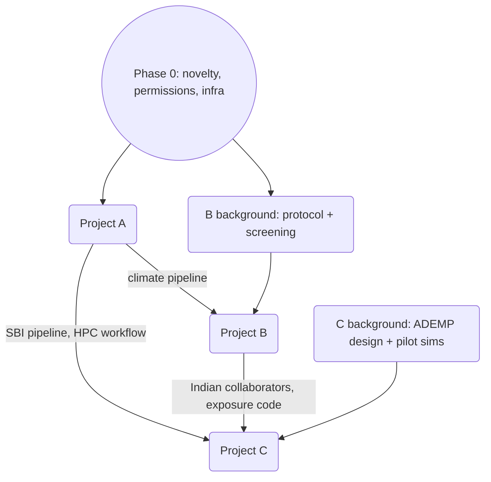

# Research Roadmap
## 0. Programme overview

### 0.1 Unifying theme

**Forecasting climate vulnerability under explicit uncertainty, from forest stands to genomes.** Each project makes a forecast or a forecast-relevant assessment, and each is explicit about what the data can and can't identify.

| | Project A | Project B | Project C |
|---|---|---|---|
| **Question** | How sensitive is Western Ghats wet-evergreen tree demography to dry-season deficit and heat, and what does that imply under CMIP6? | Where do India's KMGBF genetic-diversity indicators stand? Where is genetic data coverage missing for the species most exposed to climate change? | When can genomic data tell us which populations will persist under climate change, and what does genomic offset add beyond the magnitude of change, population size and genetic variance? |
| **Type** | Empirical ecology plus mechanistic model | Systematic review, indicator assessment, macroecology | Simulation study with two empirical anchors |
| **Inference** | Hybrid likelihood + NPE | Phylogenetic GLMM, SDM/niche metrics | Oracle ladder, ML classifiers, theory baseline, NPE mechanistic forecast |
| **Submission (target)** | M15 | M26 | M46 |
| **Skills carried forward** | SBI, climate pipeline, HPC workflow → C | Climate exposure code, Indian conservation-genetics network → C anchors | NPE forecasting reuses A's pipeline |

### 0.2 Constraints and what follows from them

- **0.5 FTE, single researcher.** Researcher time is the binding constraint, so:
  - Only one project is in its *primary* phase at any time.
  - Low-intensity background tasks (about 10–20% of time) run alongside: literature screening for B, the design document and pilot simulations for C.
  - Simulations run unattended on HPC while you write.
  - B needs a **second screener** for part of the systematic review: a student, intern or collaborator, for a 20% double-screened sample.
- **Supercomputer access.** Compute isn't limiting, so:
  - Prefer designs that are heavy on compute and light on human effort: large simulation budgets, ensembles of NPEs, and full factorial sensitivity analyses in place of hand tuning.
  - Still benchmark runtimes. Access is already in place, so no allocation proposal is needed (decided 2026-11-23).
  - Use job arrays, checkpointing and containers (Apptainer).

### 0.3 Dependencies

### 0.4 Effort budget (in half-time months, which equal calendar months at 0.5 FTE)

| Block | A | B | C (including the mechanistic forecast, §5.9) |
|---|---|---|---|
| Novelty, permissions, design, pre-registration | 1.0 | 1.0 | 2.5 |
| Data acquisition and cleaning | 2.0 | 3.5 (review + extraction) | 0.5 (anchors) |
| Model or pipeline building | 4.0 | 2.0 | 6.0 |
| Inference, analysis, validation | 4.0 | 2.5 | 6.5 |
| Writing and co-author review | 2.0 | 2.0 | 3.5 |
| **Total** | **13** | **11** | **19** |
| Revisions (later, overlapping) | 2 | 2 | 2.5 |

---

## 1. Before writing code (Phase 0, M1–M2)

### 1.1 Novelty checks

Use **three methods** for each project. Log every hit in a spreadsheet with columns *citation | what it does | overlap with us | our delta | verdict*.

1. **Boolean searches** in Web of Science, Scopus, Google Scholar, bioRxiv and EcoEvoRxiv. For B, also search Shodhganga, which holds Indian theses.
   - *Project A (done 2026-11-23):* searched OpenAlex, Crossref and Semantic Scholar instead. Scopus, Web of Science and Google Scholar were deliberately not searched, and the search is closed (`docs/decisions.md`). Report the databases actually used in the methods.
2. **Forward and backward citation chasing** from the 3–5 anchor papers listed for each project below.
3. **Ask 2–3 experts** (prospective co-authors) to name the closest work.

**Search strings**

- **A:**
  - ("tropical forest" OR "rain forest" OR "wet evergreen") AND ("individual-based" OR "forest gap model" OR "forest simulator" OR "FORMIND" OR "TROLL" OR "perfect plasticity") AND ("Bayesian calibration" OR "approximate Bayesian" OR "simulation-based inference" OR "neural posterior").
  - "Western Ghats" AND (mortality OR growth OR recruitment) AND (drought OR "water deficit" OR climate).
  - "Uppangala" (every paper that uses the plot).
  - (tree mortality OR tree growth) AND ("dry season" OR "water deficit") AND (monsoon OR India OR "South Asia").
- **B:**
  - ("genetic diversity" OR "population genetic*" OR microsatellite OR SNP) AND India AND (conservation OR monitoring).
  - ("Ne 500" OR "effective population size" OR "genetic diversity indicator*" OR "Kunming-Montreal") AND (India OR "South Asia").
  - "macrogenetic*" AND (India OR "South Asia" OR tropic*).
  - ("climate exposure" OR "climate vulnerability") AND "genetic" AND India.
- **C:**
  - "genomic offset" OR "genetic offset" OR "genomic vulnerability" AND (persistence OR extinction OR "population decline" OR "population viability" OR demograph*).
  - "evolutionary rescue" AND (gradient OR "moving optimum") AND (genomic OR "genetic diversity" OR "runs of homozygosity" OR load).
  - (SLiM OR "forward simulation") AND ("extinction risk" OR "inbreeding depression" OR "genetic load") AND (predict* OR "machine learning").
  - ("simulation-based inference" OR "neural posterior") AND ("extinction" OR "population viability" OR "forecast").

**Anchor papers for citation chasing**

- A: Rüger et al. 2020; Hartig et al. 2014; Pélissier et al. 2011 (the Uppangala data paper); Bennett et al. 2015.
- B: Pearman et al. 2024; Mastretta-Yanes et al. 2024; Hoban et al. 2020/2023; Csilléry et al. 2025 (GenDivRange).
- C: Láruson et al. 2022; Lind & Lotterhos 2025; Gain et al. 2023; Bay et al. 2018; Kyriazis et al. 2021.

**Deliverable.** For each project, one sentence in the form "The closest existing work is X; we differ by Y; Y matters because Z". Paste it into the project's §x.2 below.

### 1.2 Decision gates and kill criteria (master table)

Every gate is quantitative. "Reframe" means the project continues with a narrower claim. "Kill" means the project is dropped and its time goes to the next one.

| Gate | When | Pass criterion | If it fails |
|---|---|---|---|
| **P0** Programme | M2 | Permissions and data terms confirmed for Uppangala and Anamalai; NBA/DSI position documented; HPC allocation granted. **Project A: assumed met (2026-11-23):** data use is assumed permitted and HPC access is already available, so Project A schedules no permission or allocation steps. The NBA/DSI question remains open for B and C | Delay A's analysis (not data cleaning) until resolved |
| **A1** Novelty | M2 | No published climate-forced demographic model calibrated on Uppangala or other Western Ghats plots | Reposition around what the competitor lacks (likely the observation model, the identifiability analysis, or joint multi-site calibration) |
| **A2** Data audit | M3 | Inclusion threshold, census dates per stem, census completeness for 2007/2010, and POM changes are all documented | If 2007/2010 are partial, the hold-out becomes the matching subplots, plus leave-one-site-out |
| **A3** Identifiability | M9 | On synthetic data at the 3 representative parameter sets: posterior SD ≤ 0.5 × prior SD for **at least the mortality–deficit and growth–deficit sensitivities**, and SBC ranks uniform (χ² test p > 0.01 for each parameter, with visual check) | Reframe RQ3 as conditional projections plus a detectability analysis (§3.7). Never kill A for this |
| **A4** Misspecification | M11 | Observed summaries inside the 99% prior-predictive envelope; misspecification score below threshold | Revise model structure (one iteration allowed), then report residual misfit openly |
| **B1** Data count | Week 2 | GenDivRange plus a quick NCBI query gives ≥ 30 Indian species with georeferenced population-level diversity | B goes ahead anyway: the KMGBF indicators don't need genetic data. Narrows the genetic-data overlay |
| **B2** Inventory | M18 | ≥ 60 species in the Tier-1 pool with genetic data (about 10 events per predictor for 6 predictors) | Predictors-of-data-presence analysis becomes descriptive (no inferential model) |
| **B3** Exposure | M19 | ≥ 100 Tier-1 species with usable range maps or ≥ 30 cleaned occurrences | Restrict the exposure overlay to the taxa that pass |
| **C1** Pilot | M27 | (i) local adaptation established before the shift (home-versus-away fitness advantage > 0 in ≥ 90% of runs); (ii) load and mean fitness at equilibrium (trend over the last 20% of burn-in within ± 2%); (iii) deme extinction prevalence 20–80% across the pilot design; (iv) GF and RDA offsets computable with no degenerate fits in ≥ 95% of runs; (v) ≤ 2 CPU-hours per run *after* the burn-in, so the main design fits the allocation | Simplify (shorter genome, fewer QTL levels) and rerun the pilot once; if it fails again, reduce the design to a 1-D gradient with one trait |
| **C2** Oracle ladder pilot | M30 | Rung 1 (true maladaptation) beats climate distance on within-scenario C-index in ≥ 1 design region | If not, the headline becomes "maladaptation, even when known exactly, doesn't predict persistence beyond the magnitude of change". That is still publishable. No kill |
| **C3** Forecast scope | M36 | An NPE pilot recovers ≥ 3 of the latent quantities (Ne, V_A, lag, load) with expected coverage within ± 5% | The forecast stays in Project C, built only on the latent quantities that *are* recovered. Which quantities genomic and count data can't recover is reported as a result in its own right (it limits any genomics-based forecast). No spin-out |

### 1.3 Data access, ethics and governance (owner: you; M1–M2)

- **Biological Diversity Act 2002 as amended in 2023, and the rules that followed.**
  - Confirm with your institution's research office whether (a) using published Indian biological data and (b) reusing **digital sequence information** (tiger genomes, Indian population-genetic data) by you or your collaborators needs NBA approval, notification or a benefit-sharing declaration.
  - Record the answer in `docs/governance.md`. VERIFY the current rules; they changed in 2023–24.
- **Data owners and authorship.** Write to the data holders before analysis:
  - Uppangala: French Institute of Pondicherry (IFP).
  - Anamalai: Nature Conservation Foundation (NCF) and partners. The Zenodo 10426970 metadata names a contact person.
  - The 96-site network: IFP, Karnataka Forest Department.

  Agree co-authorship and acknowledgement in writing before analysis. Apply the CARE principles and credit Indian data generators fairly.
- **Tiger genomic data.**
  - Check the terms for each SRA BioProject.
  - Ask a tiger-genetics collaborator whether population-level results raise NTCA or State Forest Department sensitivities.
  - Don't publish fine-scale locations of sampled individuals.
- **Licences.** Record the licence of every dataset in the data dictionary. Check whether you can redistribute derived data before archiving on Zenodo.
- **Occurrence data of sensitive species** (B): coarsen coordinates for species whose records are withheld or obscured on GBIF or IBP.

### 1.4 Pre-registration and reporting standards

| Item | A | B | C |
|---|---|---|---|
| Pre-registration (OSF) | Analysis plan: hypotheses, model set, scoring rules, gates. Register at M8, before Gate A3 | Systematic-review protocol (PRISMA-P), registered at M4 before screening | ADEMP simulation protocol, registered at M26 before the main runs |
| Model description | ODD (2020 update) for the IBM; TRACE documentation | – | ODD for the SLiM model |
| Reporting checklist | TRACE | PRISMA 2020 flow diagram and checklist | ADEMP, with Monte Carlo SEs for every performance measure |
| Archive | Zenodo DOI: code, container, processed data, simulation registry | Zenodo DOI: inventory database, code | Zenodo DOI: code, container, simulation registry, summary tables (not raw tree sequences unless small) |
| Preprint | bioRxiv/EcoEvoRxiv at submission | Same | Same |

**Notes on these standards**

- TRACE stands for "TRAnsparent and Comprehensive Ecological modelling documentation" (Grimm et al. 2014). It structures model "evaludation", a term from Augusiak et al. 2014.
- ODD stands for Overview, Design concepts, Details. Use the 2020 update (Grimm et al. 2020, *JASSS*).

---

## 2. Shared infrastructure

### 2.1 Software stack (as few languages as possible)

| Role | Tool | Notes |
|---|---|---|
| A: forest IBM | **Julia**, Agents.jl, or a hand-written struct-of-arrays simulator if Agents.jl overhead dominates (benchmark both) | Simulator only. Called from Python through `juliacall`. VERIFY `juliacall` behaviour with multithreading on your HPC |
| A: likelihood vital rates | **Turing.jl** (Julia) or **Stan/brms** (R) | Pick one. Turing keeps A in Julia and Python; Stan is better tested for hierarchical GLMMs |
| A, C: SBI | **Python** `sbi` (NPE, ensembles), plus `torch` | All inference in Python. ABC is dropped (A's primary contribution is ecological) and can be added later only if a reviewer asks (`pyabc`) |
| B: inventory, SDMs, indicators | **R**: `rgbif`, `rredlist`, `terra`, `sf`, `CoordinateCleaner`, `biomod2` or `maxnet`, `blockCV`, `MCMCglmm`/`brms`, `ape`/`phytools` | One SDM ecosystem only (R). SpeciesDistributionToolkit.jl dropped |
| C: simulation | **SLiM 5** (multi-chromosome; VERIFY the current version and features) with tree-sequence recording | Pin the exact version in the container |
| C: genomics | **Python**: `tskit`, `pyslim`, `msprime`, `scikit-allel`; **R**: `gradientForest`, `vegan` (RDA), `LEA` (geometric GO, LFMM) | R reference implementations are ground truth for offsets. GenomicOffsets.jl only if cross-validated against R (VERIFY maintenance) |
| C: ROH, Ne | `bcftools roh` or `plink --homozyg` (fixed settings); an LD-Ne implementation (NeEstimator logic or `currentNe`; VERIFY) | Same settings for simulated and empirical data |
| ML | `scikit-learn`, `xgboost`/`lightgbm`, `shap` (with caution) | |
| Workflow | **Snakemake** | Separate `simulate` targets (expensive, cached) from `analyse`/`figures` targets (cheap) |

Package maintenance: before depending on any package, record its last release, open issues and test coverage in `docs/dependencies.md`. Apply the same check you applied to EvoDynamics.jl to every package, including ApproxBayes.jl (now dropped) and GenomicOffsets.jl.

### 2.2 Reproducibility and HPC

- **Environment locks:** `Manifest.toml` for Julia, `uv.lock` or `conda-lock` for Python, `renv.lock` for R. Build one **Apptainer** image per project from these locks and record the image hash in every output's metadata.
- **Simulation registry:** a Parquet or SQLite table with one row per simulation. Columns: run ID, replicate-group ID (shared burn-in), parameter vector, seed, software versions and image hash, start/end time, exit status, path to outputs, and a summary-statistic vector.
  - Every analysis reads from the registry, never from loose files.
  - Grouped cross-validation (C) and SBC (A) depend on clean group IDs.
- **Seeds:** derived deterministically from the run ID (for example `hash(run_id) mod 2^31`).
- **HPC pattern:** job arrays of about 1,000 tasks; each task runs a batch of simulations and appends to a shard of the registry. Checkpoint SLiM burn-ins as `.trees` files so they can be reused.
- **Repository layout (target):** `projectA/`, `projectB/`, `projectC/`, `shared/climate/`, `shared/hpc/`, `docs/`, `archive/`. Each project has `config/`, `workflow/Snakefile`, `src/`, `results/` (git-ignored) and `manuscript/`.
  - *Note:* this is where the repository ends up, not where it starts. It starts with a minimal skeleton (created 2026-11-22; see [README.md](README.md)): `planning/`, `docs/`, `shared/` (`climate/`, `sbi/`), and `projectA/` containing `data/`, `src/`, `docs/`, `results/` and `manuscript/` (LaTeX). Each remaining piece is added when a Project A activity first needs it:
    - `config.yaml` at A09;
    - the Snakemake workflow at A12–A13;
    - the `WGForest.jl` package at A18;
    - the container and HPC profile at A20;
    - the simulation registry at A24.

    A08 (done 2026-11-23) set up the Python environment only: `pyproject.toml` and `uv.lock` at the repo root (Python 3.13, uv), pytest tests in `projectA/tests/`, and `docs/dependencies.md`. Julia and R environments are created at A15/A18.

    `projectB/` and `projectC/` are created when those projects start. The trigger for each piece is also listed in `projectA/README.md`.
- **Tests:**
  - A: unit tests for every vital-rate function and for the observation model, including a test that simulated "censuses" reproduce the threshold and interval logic.
  - C: a regression test that a fixed seed reproduces a stored summary vector.

### 2.3 Common climate pipeline (`shared/climate/`)

**Historical data**

- IMD gridded daily rainfall at 0.25° (built from 6,000+ stations).
- IMD gridded temperature: historically 1°; VERIFY whether a finer operational product exists.
- CHELSA (about 1 km, topographically downscaled) for monthly climatologies and time series. VERIFY the CHELSA time-series coverage period.
- **Plot-scale validation:** compare gridded rainfall with any station or estate rain-gauge records near the plots (Valparai estates; Forest Department stations near Uppangala). Quantify the bias. Rainfall on the Western Ghats escarpment can vary by a factor of 2 within one 0.25° cell.
  - Lead from A01: Bankar et al. 2025 (preprint) evaluated six gridded and satellite rainfall products (CHIRPS, MSWEP, IMERG, AgERA5, GSMaP, PERSIANN-CCS) against a dense Karnataka state rain-gauge network. Check for gauges near Uppangala, and consider those products as alternatives to IMD where they perform better. Kunnath-Poovakka et al. 2020 describe bias correction of satellite rainfall across the Western Ghats.

**Projections**

- NEX-GDDP-CMIP6 (0.25°, bias-corrected and downscaled; evaluated for India).
- CHELSA-CMIP6 layers for bioclimatic variables (B).
- CMCC-BioClimInd (Noce et al. 2020; VERIFY) as an alternative set of bioclimatic indices.

**Variables**

- Monthly precipitation; Tmax and Tmin; potential evapotranspiration (PET).
- **PET formulation:** Penman–Monteith if radiation and humidity are available, otherwise Hargreaves. Document the choice and test sensitivity by comparing the two.
- **Water deficit:** climatic water deficit = Σ max(0, PET − P) over the dry season. Also dry-season length (months with P < PET, or P < 100 mm) and hot-day metrics (days with Tmax > the 95th percentile of the baseline).
- At very wet sites (around 5,000 mm/yr) annual totals mean little. **Dry-season metrics are the primary variables.**

**Linking historical and future data**

- Use the **delta-change method**: apply model-simulated changes, relative to each model's own 1985–2014 baseline, to the IMD/CHELSA plot-scale baseline. Alternatively, quantile-map NEX-GDDP to the plot-scale series.
- Never splice raw IMD to raw NEX-GDDP; that would cause a step change at 2015.

**GCM selection**

1. Exclude "hot models" whose equilibrium climate sensitivity (ECS) or transient climate response (TCR) falls outside the IPCC AR6 likely range (Hausfather et al. 2022).
2. From the remaining models, choose 5–8 that **span** the projected change in dry-season rainfall and temperature over the Western Ghats (a storyline/envelope approach). A skill screen over India can remove models that are clearly unrealistic, but must not narrow the projected spread.
3. Document the selection in `shared/climate/gcm_selection.md`.

**Scenarios:** SSP1-2.6, SSP2-4.5 and SSP3-7.0 as the main set, with SSP5-8.5 labelled a high-end bound.

**Horizons:** 2041–2060 ("2050") and 2071–2090 ("2080"), with 1985–2014 as the baseline.

---

## 3. Project A: Climate sensitivity of Western Ghats wet-evergreen tree demography

### 3.1 One-sentence claim (target)

Dry-season water deficit and heat measurably change tree mortality and growth in Western Ghats wet-evergreen forest. Under CMIP6 scenarios, these sensitivities imply [direction and size] changes in basal area and guild composition by 2050 and 2080, with uncertainty partitioned among parameters, climate models, scenarios and demographic stochasticity.

### 3.2 Closest work and our contribution (from A01, 2026-11-23; Gate A1 passed)

Full evidence: `projectA/docs/novelty/A01_novelty_report.md` and `A01_screened_hits.csv`.

> The closest existing work is Machado et al. (2023), who found weak drought effects on tree survival at Uppangala. We differ by estimating continuous dry-season deficit and heat sensitivities of growth, survival and recruitment within a calibrated, validated stand model with an explicit observation model and detectability analysis. This matters because only that combination can say whether the climate signal is real, how much data would be needed to detect it, and what it implies for Western Ghats forests under CMIP6.

| Closest work | What it does | Our contribution |
|---|---|---|
| **Machado et al. 2023, *Biotropica* (closest competitor; full text read, see `projectA/docs/novelty/Machado2023_notes.md`)** | Bayesian hierarchical survival model on the same public Uppangala data (E092-115-D1). Drought is a binary indicator for the 2001–07 interval (2002 drought, from 0.5° SPEI; no local climate data). Mortality 0.72 → 1.07 %/yr; community β1 = −0.39 (logit); no size dependence; understorey guild most sensitive, emergent marginal, canopy no effect. They call for process-based modelling and for analysing the 2009 and 2016–18 droughts | Growth, survival and recruitment jointly; continuous deficit and heat (plot-scale climate) with lags; observation model; detectability limits; second site; held-out validation; projections |
| Le Bec et al. 2015, *PLoS ONE* | Hierarchical growth model on 21 years of Uppangala diameter increments (size, competition) | Adds climate and the other vital rates; growth becomes one module of a calibrated stand model. Compare Stage-1 growth estimates with theirs |
| Earlier Uppangala individual-based models: Moravie et al. 1997, *Ecol. Model.*; Houllier et al. 1997; Le Bec 2014 (PhD thesis, HAL tel-01116564: SELVA simulator on the Capsis platform, plus Cox and joint growth–survival models) | Canopy regeneration and tree architecture; stand resilience after disturbance driven by individual growth variability | Climate forcing, recruitment, formal calibration and observation model, quantified identifiability, CMIP6 projections. Le Bec's joint growth–survival models are a Stage-1 precedent on the same data |
| Coarse-scale projections for Indian forests: Fitha et al. 2026 (LPJ-GUESS forced by CMIP6); Ghosh et al. 2025 (preprint); Das et al. 2022 (MC2) | LPJ-GUESS projects carbon increases (smaller in the Western Ghats), while Ghosh et al. project savannization of major Indian forests by the late 21st century | Plot-calibrated, demography-based, validated projections. The disagreement between the coarse-scale projections is itself a motivation; contrast all three in the discussion |
| Krishnadas et al. 2021, *Global Ecol. Biogeogr.* | Seasonal drought structures Western Ghats tree species distributions and communities | Demographic rates rather than occurrence; supports dry-season deficit as the primary climate variable |
| Suresh et al. 2010, *For. Ecol. Manage.* (Mudumalai) | 19-year record: mortality tracks rainfall with a 2–3-year lag (dry forest) | Wet evergreen forest, mechanistic model; motivates the lagged-deficit alternative (§3.5.2) |
| Aubry-Kientz et al. 2013/2015 (Paracou) | Bayesian coupling of growth and mortality to identify climate drivers | Methods template for Stage 1, applied to an Asian monsoon forest with recruitment and projections |
| Rüger et al. 2020, *Science* | A PPA model with five demographic groups at BCI | A monsoon forest in India, explicit climate sensitivity, held-out validation |
| Hartig et al. 2014, *Biogeosciences* | ABC calibration of FORMIND | Hybrid likelihood + NPE, misspecification diagnostics, identifiability gate |
| Tropical drought-mortality literature (Bennett et al. 2015; others) | Large trees are more vulnerable to drought | Tests this in an Asian monsoon forest with 20–30 years of mapped data |

**Primary contribution:** ecological (climate sensitivity and its consequences).
**Secondary contribution, kept short in the methods and supplement:** checking the SBI component against likelihood posteriors on real data (§3.6.4).

### 3.3 Research questions and hypotheses

| ID | Hypothesis (prediction) | Test | If null |
|---|---|---|---|
| **H-A1** | **Primary:** the annual mortality hazard increases with dry-season water deficit. **Secondary:** the effect is stronger for large trees (hydraulic risk; Bennett et al. 2015). Machado et al. 2023 found no size dependence in these data, so the secondary prediction is tested with its detectability stated up front | Primary: the posterior of the deficit coefficient in the survival model is > 0, with the 95% CrI excluding 0. Secondary: the posterior of the deficit × size interaction, reported next to its minimum detectable size from §3.7 | Report the posterior and the **minimum detectable effect** given the data (§3.7); state how many more census years would be needed. A null secondary result below the minimum detectable size is reported as "not detectable", not as "no effect" |
| **H-A2** | Girth growth declines with dry-season heat (Tmax) and deficit | Growth-model posteriors for both coefficients are < 0 | Same as H-A1 |
| **H-A3** | Sensitivity to deficit differs among guilds, under two pre-specified schemes. **(a) Canopy-position guilds** (emergent, canopy, subcanopy, understorey; Pélissier et al. 2011b Table S4): survival of the **understorey** guild is the most sensitive and the canopy guild the least (replicates Machado et al. 2023). **(b) Trait-based guilds** (A11): low-wood-density guilds are more sensitive | Guild-specific posteriors under each scheme; posterior probability of the predicted ordering. (a) is supported if the understorey deficit effect excludes 0 (95% CrI) and is the most adverse of the four. On the 1990–2010 data, (a) is a re-analysis with continuous deficit, not an independent replication; it is independent only on post-2010 censuses or the second site | Report a shared sensitivity. Guild composition then shifts only through structural effects. A reversal of the understorey result under (a) is reported as a failure to replicate |
| **H-A4** | A climate-informed model beats a climate-free null at predicting held-out censuses | CRPS or log-score difference, with a bootstrap CI over stems or subplots | Climate signal is undetectable at this scale. Projections are reported as conditional on literature-informed priors and labelled as such |
| **H-A5** | Under SSP2-4.5 and SSP3-7.0, basal area declines by 2080, and guild composition shifts toward the less drought-sensitive guilds identified under H-A3. Attribution of the decline to large-tree mortality is claimed only if the H-A1 size interaction is detected | Posterior predictive distribution of change, with uncertainty partitioned (§3.8) | Report "no detectable change" with its uncertainty band, which is informative in itself |

**RQ1 (fit)** is assessed only on **held-out** data. Fit to the calibration data is reported as a diagnostic, not as a result.

**Positioning of H-A1 and H-A3 (from A01).** Machado et al. 2023 already tested drought effects on survival, including differences among canopy strata, on the same Uppangala data, and found only a marginal effect. H-A1 and H-A3 are therefore framed as building on that result:
- They extend a contrast around one drought to continuous sensitivities to deficit and heat, for growth and recruitment as well as survival.
- They make the size interaction secondary (Machado et al. found none) and report its minimum detectable size.
- They test both canopy-position and trait-based guilds, with Machado et al.'s understorey result as an explicit replication prediction.
- They report a minimum detectable effect, so a weak signal becomes an interpretable result rather than a null.

**Full text read (2026-11-23).** Its findings led to the rewording of two hypotheses, **adopted 2026-11-23** (table above; `docs/decisions.md`):
- **H-A1:** Machado et al. found **no size dependence** of the drought effect on survival. They attribute this to the > 30 cm GBH threshold and to few trees > 100 cm DBH. The deficit × size interaction may not be detectable in these data. Adopted: the main deficit effect is the primary prediction and the size interaction secondary, with its minimum detectable size reported (§3.7).
- **H-A3:** they found the **understorey** guild most sensitive, emergents marginal and the canopy unaffected. That differed from the original prediction ("low-wood-density and evergreen-canopy guilds are more sensitive"). Their canopy-position guilds (emergent, canopy, subcanopy, understorey; Pélissier et al. 2011b Table S4, distributed with the data) give a ready candidate scheme next to the trait-based one (A11). Adopted: test both schemes, with replication of the understorey result as an explicit prediction. The trait-based prediction drops "evergreen-canopy guilds are more sensitive", which contradicted the understorey prediction.
- **Priors and Gate A3:** use their effect sizes (mortality 0.72 → 1.07 %/yr over the drought interval; logit β1 ≈ −0.4, converted to a per-unit-deficit effect) for a weakly informative prior and to set the "medium" synthetic parameter set (§3.7).

### 3.4 Data

#### 3.4.1 Datasets

- **Uppangala permanent sample plot** (Pushpagiri Wildlife Sanctuary, Karnataka; IFP).
  - 5.07 ha, 3,870 tagged and mapped trees (all trees ever recorded, 1990–2010), with dendrometer bands.
  - Censuses: 1990–1993 (initial, staggered), 1994, 1997–98, 2001–02, 2007 and 2010 (C0–C5 in Machado et al. 2023). Inclusion threshold > 30 cm GBH (> 9.5 cm DBH), confirmed by Machado et al. 2023. Their data had 3,672 unique trees of 102 species.
  - Data paper: Pélissier et al. 2011, *Ecology*, Ecological Archives E092-115, doi:10.1890/10-1991.1 (verified 2026-11-23).
  - Listed in BioTIME (study 329; VERIFY).
  - From the data (A02): every census covered all plots, including 2007 and 2010. Census dates are per field trip, not per stem. No POM variable; dendrometer-band changes are counted. Species list includes each species' potential stratum (emergent, canopy, subcanopy, understorey), the canopy-position guilds for H-A3(a). Details: `projectA/docs/data_dictionary.md`.
  - **Primary calibration and validation site.**
- **Further Uppangala data found in A01** (see `docs/governance.md`). **Not requested for now:** Project A makes no data-owner contact (decided 2026-11-23) and uses the public data only. Kept as leads:
  - **Re-census to 2021** of four logged and two unlogged 1-ha plots (Wilson et al. 2022, *Environ. Monit. Assess.*; stems ≥30 cm GBH). It could extend the temporal hold-out past 2010, including the 2015–16 drought years, at least for the unlogged plots.
  - **Small-stem plot:** 1 ha, stems ≥1 cm DBH, with a first re-census (Drishya et al. 2026). It could directly constrain the latent sapling pool and recruitment module (§3.5.3), the least identified part of the model.
  - **Traits and LiDAR for a 10-ha plot:** leaf and wood traits of 89 species, 99% of individuals (Schmitt et al. 2021, *J. Veg. Sci.*). Ready-made inputs for trait-based guilds (A11); their canopy/understorey guild split is a candidate scheme.
  - Also ask whether the main 5.07-ha plot was re-censused after 2010. This is now a priority: Machado et al. 2023 point to further droughts in **2009 and 2016–2018**, after the public record ends. Post-2010 censuses would add the only other drought events available for estimating climate sensitivity.
- **Anamalai Hills long-term plots** (Zenodo 10426970).
  - Two 1-ha plots, censused every year from 2017 to 2022: mature forest in Anamalai Tiger Reserve and secondary forest on the Valparai Plateau.
  - Stem coordinates and alive/dead status; RAINFOR-GEM protocol. Stems **≥ 10 cm GBH** (lower than Uppangala's 30 cm; truncate for the joint fit); POM recorded per stem. CC-BY-4.0.
  - Contact person listed in the Zenodo metadata.
  - **Second calibration site (joint fit) and transfer test.**
- **Central Western Ghats 96-site network** (Karnataka).
  - 76,813 trees and lianas of 446 species, sampled in 1996–97 across about 22,000 km²: 61,965 stems ≥ 10 cm GBH in 96 one-hectare macroplots, plus 14,848 smaller individuals in microplots.
  - Includes environmental covariates and degradation levels (structural integrity 1–3).
  - Ramesh et al. 2010, *Ecology* 91:3118, Ecological Archives E091-216, doi:10.1890/10-0133.1 (verified 2026-11-23).
  - Its species list gives maximum-height class and leaf phenology for 446 species: a ready trait source for guilds (A11).
  - **A single snapshot with no demographic rates.** Used only for a space-for-time consistency check (§3.8.4) and for trait/guild coverage.
- **Additional data**, to be examined; include only if it has individual-level remeasurements:
  - BioTIME study 813 (10 half-hectare plots, 2002–2022, 180 species, Kerala; VERIFY the ID and whether individuals are tracked).
  - NCF datasets from the Valparai Plateau and Anamalai Tiger Reserve.
  - TreeGhatsData (VERIFY that it exists and is accessible).
  - Varagalaiar 30-ha plot, Anamalais (Ayyappan & Parthasarathy 1999, 2004): a possible third evergreen site if it has been re-censused.
- **Traits for guilds:**
  - Wood density from the Global Wood Density Database (Zanne et al. 2009).
  - Maximum height or adult stature from the plot data.
  - Leaf phenology (evergreen versus deciduous) from floras.
  - Shade tolerance from the literature or inferred from the size distribution of recruits.
  - Check coverage in M2. Aim for ≥ 80% of basal area with trait values.
- **Climate:** §2.3, at plot scale.

#### 3.4.2 Observation-process audit (Gate A2, M3)

Document the following in `projectA/docs/observation_process.md`. Each item becomes part of the simulator's **observation model**.

| Item | Why it matters | What to record |
|---|---|---|
| Inclusion threshold (girth at breast height; Uppangala > 30 cm GBH, confirmed by Machado et al. 2023) | Recruitment is ingrowth over the threshold, not establishment | Threshold for each site and census |
| Census date for each stem | Census intervals are unequal and staggered | Date for each stem where available, otherwise the census midpoint |
| Census completeness (especially 2007 and 2010) | Determines the hold-out design | Area covered by each census |
| Point of measurement (POM) changes and buttresses | Spurious growth | POM flags and the cleaning rule |
| Negative or extreme growth | Measurement error | Error-model parameters (estimated from remeasurement outliers or a literature value) |
| Missed or resurrected stems | Bias in mortality and recruitment | Count and rule |
| Plot edges and neighbours outside the plot | Bias in neighbourhood crowding | Buffer width used |
| Species identification changes across censuses | Mixed-up guild assignment | Taxonomic harmonisation table (one backbone: POWO/WFO) |
| Dominant species | Guild summaries may reduce to a single species | Share of basal area of the top 5 species (*Vateria indica*, *Dipterocarpus indicus*, *Humboldtia brunonis*, …; VERIFY) |

### 3.5 Model design

#### 3.5.1 Architecture

- **Two-stage modular inference** (a "cut" model; Plummer 2015).
  - **Stage 1:** growth and survival of stems above the threshold have tractable likelihoods given mapped neighbours, so they are fitted by likelihood (hierarchical Bayes).
  - **Stage 2:** an IBM carries those posteriors forward and adds the parts with no tractable likelihood: the latent sapling pool, recruitment and dispersal, and stand-level feedbacks. Stage-2 parameters are inferred with NPE.
  - Stage-1 posterior draws are **propagated** into Stage 2 (sampled for each simulation), not fixed at point estimates.
  - Justification for the cut: it stops a possibly misspecified recruitment module from distorting well-identified vital rates. This is a deliberate choice and must be stated in the methods.

#### 3.5.2 Stage 1: vital-rate models (likelihood)

- **Growth:**
  - Δgirth per year = f(size) × g(crowding) × h(climate) + error.
  - f is a size-dependent potential growth (for example log-normal in size).
  - g is a neighbourhood crowding index (NCI): Σ over neighbours within r of size^α / distance^β, with r, α and β estimated.
  - h(climate) = exp(γ₁ · deficit + γ₂ · Tmax_hot + γ₃ · deficit × size).
  - Random effects: species nested in guild, a year (interval) effect, and a subplot effect.
  - **Error model:** a latent true size with measurement error (state-space), or a Student-t likelihood on increments. Decide in the data audit (M3).
- **Survival:**
  - Interval hazard with a complementary log-log link and an offset for log(interval length).
  - Covariates: U-shaped size dependence (linear and quadratic in log size), crowding, deficit, Tmax, and deficit × size (H-A1).
  - The same random-effect structure as growth.
- **Climate covariates** are averaged over each stem's actual census interval. Also test the interval *maximum* deficit, since single droughts may matter more than averages.
- **Interval-level confounding (from Machado et al. 2023).** With about 5 census intervals, climate has very few independent values at the interval level, and an interval (year) random effect can absorb the climate signal. Machado et al. compared the drought interval with earlier ones, which confounds drought with any trend across intervals. Pre-register both specifications (with and without interval random effects), and let the identifiability study (§3.7) quantify how much climate signal each can recover. Census dates add little within-interval variation: at Uppangala they are per field trip (two trips about 5 months apart in C2 and C3), not per stem (A02). Use them anyway, but don't count on them to separate climate from interval effects.
- **Lagged deficit (pre-specified alternative, from A01).** At Mudumalai, mortality of large stems tracks rainfall with a 2–3-year lag (Suresh et al. 2010). Fit a survival-model variant with deficit lagged by 1–3 years, and compare it with the unlagged model by PSIS-LOO.
- **Guilds:** 3–5 **trait-based** guilds. Cluster on wood density, maximum stature and phenology, then fix the guilds. Don't define guilds from the demographic rates being fitted (that would double-dip).
- **Second guild scheme for H-A3:** the four canopy-position guilds of Pélissier et al. 2011b (Table S4, distributed with the data). Fit the Stage-1 survival and growth models once under each scheme. The IBM (§3.5.3) uses the trait-based scheme.
- **Software:** Turing.jl or brms/Stan (§2.1). Check with posterior predictive checks, leave-one-out cross-validation (PSIS-LOO), and leave-one-interval-out cross-validation.

#### 3.5.3 Stage 2: IBM

**State**

- Stems at or above the threshold: position, girth and guild. Species identity is kept as a label for summaries, and parameters are guild-level with species random effects drawn from the Stage-1 posterior.
- **Latent sapling pool:** sapling density per guild per 10 × 10 m cell. It is a cohort, not individuals, which keeps it cheap.

**Processes, run in annual steps**

1. **Growth and survival** of stems: draws from the Stage-1 posterior.
2. **Seed input to the sapling pool:** con-*guild* adult basal area within a dispersal kernel (dispersal scale estimated), plus background input.
3. **Sapling pool dynamics:**
   - Survival depends on canopy crowding and dry-season deficit (estimated).
   - The rate at which saplings reach the threshold is estimated.
   - Saplings that reach the threshold enter as new stems, placed at random within the cell, with girth equal to the threshold.
4. **Observation model:** at each actual census date, apply the threshold, add girth measurement error, apply the missed-stem probability, and record the census.

**Initial condition and boundaries**

- Stems: the **observed 1990 map** (conditional simulation; no spin-up to equilibrium).
- Sapling pool: inferred. Prior: a guild-specific density scaled to the observed ingrowth in 1990–94.
- Boundary: a buffer. Edge stems use crowding from a toroidal reflection or from the observed density; test sensitivity to the choice.

**Forcing:** annual climate from §2.3. Hindcast with IMD/CHELSA for 1990–2022; projections from delta-changed NEX-GDDP-CMIP6 for 2023–2090.

**Parameters inferred by NPE (Stage 2), roughly 10–14**

- For each guild, or with hierarchical guild deviations: seed input, dispersal scale, background input, sapling survival intercept, sapling survival sensitivity to crowding and to deficit, and the transition rate.
- The initial sapling density for each guild.
- Per-site offsets for the joint Uppangala + Anamalai fit.

Use hierarchical guild deviations (a shared mean plus a guild deviation with a shrinkage prior) so the number of parameters doesn't grow linearly with the number of guilds.

**Structural alternatives:** the same set is fitted in Stage 1 and Stage 2.

| Model | Climate in growth | Climate in mortality | Climate in recruitment |
|---|---|---|---|
| M0 (null) | – | – | – |
| M1 | ✓ | – | – |
| M2 | – | ✓ | – |
| M3 (full) | ✓ | ✓ | ✓ |

**Out of scope, to be stated explicitly in the paper:**

- CO₂ fertilisation (discuss its likely direction).
- Fire, logging and disturbance (Uppangala is undisturbed).
- Lianas.
- Pests and pathogens.
- Changes in species pool or immigration of new species.
- Within-generation acclimation.
- Any eco-evolutionary trait dynamics. The v1 "phase 2" is removed: heritable change over 60 years in long-lived trees is negligible, so the topic belongs in C if anywhere.

### 3.6 Inference

#### 3.6.1 Stage 1

Covered in §3.5.2.

#### 3.6.2 Stage 2: NPE

- **Summary statistics.** Each is computed per site and per census interval:
  - Ingrowth counts per guild, per hectare per year.
  - Size-class distribution (5 bins) per guild at each census.
  - Basal area and stem density per guild.
  - Spatial pattern of recruits relative to con-guild adults: the mark-connection function at r = 2, 5, 10 and 20 m.
  - Pair-correlation function of all stems at the same distances.
  - Check these distance bins against Pélissier 1998 (*J. Trop. Ecol.*, doi:10.1017/s0266467498000017), which analysed young-versus-adult spatial patterns at Uppangala with pair-correlation and point-process models.
- **Optional learned summaries:** a permutation-invariant embedding network (DeepSets) on recruit coordinates plus girth. Use it only if the ablation (§3.6.3) shows that the hand-picked summaries lose information.
- **Method:**
  - An ensemble of 5–10 NPE models (neural spline flows; varied seeds and architectures).
  - Budget of **10⁵–10⁶ simulations** (compute isn't limiting; still benchmark first).
  - Amortised training across sites, with site as a context input. This is what makes the joint and leave-one-site-out fits cheap.
- **Priors:** documented in a table with the source of each (literature, Stage 1, expert). Run prior-predictive checks before any inference.

#### 3.6.3 Diagnostics

All run on synthetic data with known parameters before real data.

- Simulation-based calibration (SBC; Talts et al. 2018) with ≥ 500 synthetic datasets.
- **Expected-coverage curves** (Hermans et al. 2022). The ensemble must be calibrated or conservative.
- Posterior contraction for each parameter (Gate A3).
- **Summary-statistic ablation:** drop each summary group and measure the change in contraction.
- **Misspecification check** (Gate A4): prior-predictive envelope, plus a distance-to-training-set or classifier score in the embedding space (Schmitt et al. 2023).
- Posterior predictive checks against observed summaries, including ones *not* used in calibration (for example the size distribution of dead stems).

#### 3.6.4 Checking the inference (secondary contribution)

- Rerun Stage 2 with growth and mortality parameters **also inferred by NPE** (no cut). Compare those NPE posteriors with the Stage-1 likelihood posteriors, using classifier two-sample tests (C2ST) and the overlap of marginals.
- The question is how much information about vital rates is lost when individual data are reduced to summaries.
- Report this in a short methods paragraph plus the supplement. It validates the Stage-2 approach with a real-data reference, which is rare for an ABM.

### 3.7 Identifiability and detectability study (Gate A3, M8–M9)

- Generate synthetic data from M3 at 3 representative parameter sets (low, medium and high climate sensitivity), with the real data's structure: the same plot area, census dates and observation model.
  - Anchor the "medium" set on Machado et al. 2023: annual mortality 0.72 %/yr rising to 1.07 %/yr over the 2001–07 drought interval (logit β1 ≈ −0.4), converted to a per-unit-deficit effect. Set "low" below and "high" above it. Include a deficit × size interaction in at least one set, to estimate its minimum detectable size (H-A1).
- For each set:
  - prior-to-posterior contraction and SBC for every parameter;
  - **the minimum detectable effect** for each climate sensitivity (the smallest effect whose 95% CrI excludes 0 in ≥ 80% of replicates).
- **Detectability extension**, cheap with HPC: repeat with hypothetical longer records (+10 and +20 years of annual censuses) and more area (+5 ha). The result is a monitoring recommendation, an ecological result in its own right: how much census effort is needed to detect a given climate sensitivity in Western Ghats forest.
- **Gate A3** applies the criteria in §1.2.

### 3.8 Validation

1. **Temporal hold-out.**
   - Calibrate Stage 1 and Stage 2 on 1990–2002; predict 2007 and 2010 (or the covered subplots, per Gate A2).
   - Score the predicted stem-level survival (log score), growth (CRPS), guild ingrowth (CRPS) and stand summaries.
   - **Baselines:**
     - (i) a persistence forecast: demographic rates from the calibration period applied unchanged;
     - (ii) M0, the climate-free model.
   - Report score differences with bootstrap CIs. Resample subplots (20 × 20 m blocks) to respect spatial autocorrelation.
2. **Leave-one-site-out transfer.** Calibrate on Uppangala and predict the Anamalai mature plot, then the reverse (where the data allow).
   - **Pre-specified diagnostics:** for a misfit, attribute it to the (a) climate term, (b) guild composition or (c) recruitment module. To do this, swap in site-specific values for one module at a time and measure the improvement in score.
   - The Anamalai secondary-forest plot is a deliberate out-of-domain test (disturbance history).
3. **Within-plot spatial blocks.** Divide Uppangala into 4–6 blocks; calibrate on all but one and predict the held-out block. Give the caveat that blocks share climate and aren't independent.
4. **Space-for-time consistency (96-site network).**
   - For undegraded sites only: run the calibrated model to quasi-equilibrium under each site's baseline climate (starting from a common initial stand) and compare the predicted guild basal-area shares with the observed ones.
   - Statistic: rank correlation across sites, with a permutation null.
   - Caveat, stated explicitly: soil, elevation and history confound the comparison. This is a consistency check, not a validation.

**Final model for projections:** the joint fit to all data (Uppangala, all censuses, plus Anamalai).

### 3.9 Projections and uncertainty

- **Ensemble:** posterior draws (≥ 200) × GCMs (5–8) × SSPs (3 + high-end) × stochastic replicates (≥ 10), from 2023 to 2090.
- **Outputs:** change in basal area, stem density, large-tree (≥ 60 cm DBH) density, guild basal-area shares and annual mortality, for 2050 and 2080 relative to 2010–2022.
- **Uncertainty partition:** decompose the variance of each output into parameter, GCM, scenario and stochastic components, using a Hawkins–Sutton-style ANOVA on the ensemble.
- **Prior versus posterior projections:** rerun with draws from the *prior* for the climate sensitivities. If the two projection spreads are similar, the projection is prior-driven, and you must say so.
- **Conditional framing:** if Gate A3 fails, present the projections as "if the sensitivity lies in [range], then…", alongside the detectability result.
- **Extrapolation flag:** mark the years in which projected dry-season deficit or Tmax exceeds the range observed during calibration.

### 3.10 Figures and tables

1. Study sites, climate gradients and data timeline (censuses and climate records).
2. Model schematic: the two stages, the observation model and the cut (ODD summary).
3. Stage-1 climate effects: partial-effect plots of mortality and growth against deficit and Tmax, by size and guild (H-A1 to H-A3).
4. Identifiability and detectability: contraction, SBC, and the minimum detectable effect against census length.
5. Validation: held-out scores versus the persistence forecast and M0; the transfer diagnostics.
6. Projections by SSP and horizon, with fan charts and the uncertainty partition.
7. Table: priors, fixed parameters and sources.
8. Supplement: NPE versus likelihood posteriors (§3.6.4), summary ablation, misspecification checks, the 96-site consistency check, and the ODD and TRACE documents.

### 3.11 Timeline (M1–M15, then revisions M19–M21)

| Months | Work |
|---|---|
| M1–M2 | Phase 0 (§1). Novelty (Gate A1). Data downloads. Letters to data owners. Container and repository set-up. HPC proposal |
| M2–M3 | Data harmonisation; taxonomic backbone; observation-process audit (Gate A2); trait and guild coverage |
| M3–M5 | Climate pipeline (§2.3): plot-scale validation, PET, deficits, GCM selection, delta change |
| M4–M6 | Stage-1 vital-rate models: fitting, checks and cross-validation |
| M6–M8 | IBM implementation with observation model; unit tests; runtime benchmark; priors; ODD draft |
| M8 | Pre-register the analysis plan (OSF) |
| M8–M9 | Identifiability and detectability study (Gate A3) |
| M9–M11 | Stage-2 NPE: training, diagnostics, misspecification check (Gate A4); inference check (§3.6.4) |
| M11–M12 | Validation (§3.8) |
| M12–M13 | Projections and uncertainty partition |
| M13–M15 | Writing, co-author review, preprint, submission (M15) |
| M19–M21 | Revisions (expected) |

### 3.12 Venues and collaborators

- **Target venues** (check scope and word limits in M12): *Journal of Ecology*, *Global Change Biology*, *Ecography*. Fallbacks: *Biotropica*, *Forest Ecology and Management*, *Ecological Applications*.
- **Co-authors:**
  - A forest-dynamics ecologist linked to the Uppangala/IFP data (data owner and Western Ghats expertise).
  - An Anamalai/NCF data contact.
  - Optionally, a climate scientist for the downscaling and GCM-selection choices.

### 3.13 First two weeks

1. Run the A novelty searches and citation chasing (§1.1); log the hits.
2. Download Uppangala (data paper archive), Anamalai (Zenodo 10426970) and the 96-site data. Start the data dictionary.
3. ~~Email the IFP and NCF contacts~~ and 4. ~~NBA/DSI query; HPC allocation proposal~~: dropped for Project A (2026-11-23; data use assumed permitted, HPC already available). Census completeness and POM records are audited from the published metadata only (A10).
5. Set up the repository, the lockfiles, an Apptainer skeleton, the Snakemake skeleton and the simulation-registry schema.
6. Draft a one-page ODD overview.

---

## 4. Project B: India's genetic-diversity indicators, genetic data coverage and climate exposure

### 4.1 One-sentence claim (target)

For [N] Indian species, the KMGBF genetic-diversity indicators show [x%] of populations below Ne 500 and [y%] of populations lost. DNA-based genetic baselines exist for only [z%] of species and temporal genetic monitoring for almost none, and coverage is weakest for the most climate-exposed taxa and regions.

### 4.2 Closest work and our contribution

| Closest work | What it does | Our contribution |
|---|---|---|
| Pearman et al. 2024, *Nat. Ecol. Evol.* (doi 10.1038/s41559-023-02260-0) | Genetic monitoring effort versus trailing-margin climate exposure in Europe | A tropical megadiverse country; niche-position exposure (no latitudinal trailing-edge assumption); research-effort correction |
| Mastretta-Yanes et al. 2024, *Ecol. Lett.*; Hoban et al. 2023 | KMGBF genetic indicators for several countries | First assessment for India (VERIFY that India wasn't included), linked to climate exposure |
| Csilléry et al. 2025 (GenDivRange); global macrogenetic studies (Miraldo et al. 2016; Leigh et al. 2021) | Global compilations of genetic diversity | Indian coverage plus a systematic Indian literature search (including Indian journals and theses) |
| Oliveira et al. (*Ecol. Lett.*; VERIFY the year and authors) | Genetic diversity interacts with climate velocity to shape range shifts across 1,888 species | Context for why genetic baselines matter under climate change |

### 4.3 Concepts and terms (used strictly)

- **Genetic diversity data (baseline):** one or more DNA-based diversity estimates from a georeferenced population at a single time.
- **Genetic monitoring:** DNA-based estimates from the same population at **two or more time points**, which is the KMGBF complementary indicator.
- **Neutral versus adaptive:** most of the data are neutral markers (microsatellites, mtDNA). Neutral diversity correlates only weakly with quantitative/adaptive variation (Reed & Frankham 2001), so B doesn't claim to measure "adaptive potential".
- **Vulnerability framework** (Dawson et al. 2011; Foden et al. 2013): vulnerability = exposure × sensitivity × adaptive capacity. B quantifies **exposure** and **the coverage of genetic data relevant to adaptive capacity**. It doesn't measure sensitivity or vulnerability.

### 4.4 Research questions and hypotheses

| ID | Hypothesis / question | Test | If null |
|---|---|---|---|
| **Q-B1** (descriptive) | How many Indian species and populations have DNA-based genetic baselines and temporal monitoring, by taxon, region and marker type? | Inventory (§4.6.2) | Descriptive. Always reportable |
| **Q-B2** (indicators) | What are the values of the Ne 500 indicator, the PM indicator and the genetic-monitoring indicator for an indicator set of Indian species? | §4.6.3 | Descriptive. Always reportable |
| **H-B3** | Whether a species has genetic data is predicted by body size, charisma (use and trade), threat status and range size, **beyond** general research effort | Phylogenetic GLMM with a research-effort covariate (§4.6.6) | If only research effort matters, the genetic gap reflects a general study gap. That is a useful policy message |
| **H-B4** | The most climate-exposed species, by niche-position exposure, are **less** likely to have genetic data | A term for exposure in the H-B3 model; bivariate maps | No mismatch: genetic sampling is (by chance) aligned with exposure |
| **H-B5** | Species failing the Ne 500 indicator are concentrated in highly exposed taxa and regions | Cross-tabulation and a GLMM | Report independence |

### 4.5 Scope and species pool (defined for the question)

Each part of B gets the pool that suits it best:

| Tier | Pool | Used for | Why |
|---|---|---|---|
| **Tier 1 (inferential core)** | All native Indian **terrestrial and freshwater vertebrates** (mammals, birds, reptiles, amphibians) with IUCN assessments. Add freshwater fishes if range maps are adequate (decide at M15) | H-B3, H-B4, exposure | Complete species lists, expert range maps (IUCN/BirdLife), phylogenies (VertLife; VERIFY), trait covariates (body mass, habitat), and IUCN status are all available, so the denominator is clear |
| **Tier 2 (indicator set)** | A **stratified sample of about 100–150 species** across vertebrates, vascular plants (including Western Ghats endemic trees), and selected invertebrates with data. Stratified by taxon × threat × range size, following the multinational protocol | Q-B2, H-B5 | The indicators don't need genetic data, but they need population delineation and census-size information, which is only feasible for a sample. Expert elicitation via Indian collaborators |
| **Tier 3 (descriptive only)** | Crops, crop wild relatives, livestock breeds, fisheries stocks, invasive species | Q-B1 tallies | Their genetic data are driven by breeding and management, which is a different process. Pooling them would confound the gap analysis. They are reported separately |

### 4.6 Methods

#### 4.6.1 Gate B1 (week 2)

Count Indian entries in GenDivRange and run a quick NCBI SRA/BioProject query with country = India and population-level sampling. Also VERIFY GenDivRange's contents: 19,173 populations of 1,109 species, mostly microsatellites, and its regional composition.

#### 4.6.2 Systematic inventory (PRISMA 2020)

- **Protocol (PRISMA-P)** registered on OSF at M4. Screening runs as a background task at about 10% time from M5 to M14, then becomes primary work.
- **Sources:**
  - Web of Science, Scopus, Google Scholar (the first 300 hits per string);
  - Indian outlets (*Current Science*, *Journal of Genetics*, *Journal of Threatened Taxa*);
  - Shodhganga (theses);
  - NCBI SRA/BioProject metadata;
  - Dryad, Zenodo and GenDivRange.
- **Inclusion criteria:**
  - wild populations (Tier 1/2) of taxa occurring in India;
  - DNA-based markers;
  - population-level estimates of diversity (H_e, H_o, π, allelic richness) or raw genotypes;
  - a sampling location that can be georeferenced to within ≤ 25 km.
- **Exclusions:** studies of phylogeny or species delimitation only, unless they report population diversity.
- **Screening:** you screen everything. A second screener double-screens a random 20% at the title/abstract and full-text stages. Report Cohen's κ and resolve conflicts by discussion.
- **Extraction fields:** species (on the GBIF backbone); population ID; coordinates with an **uncertainty radius** (point-radius georeferencing best practice); marker type and number of loci or SNPs; sample size; diversity metrics; sampling year(s); temporal replicates (Y/N, years); whether raw genotypes are archived (Y/N, location).
- **Effort components** are reported separately, with no composite index: number of populations, number of individuals, marker class, recency, temporal replication, and whether raw data are archived. Any summary ranking is checked for robustness by varying weights over a grid.
- **Deliverable:** a public inventory database. It can become a companion data paper (*Scientific Data*, an *Ecology* data paper, or *GigaByte*; check scope).

#### 4.6.3 KMGBF genetic-diversity indicators (Tier 2)

The indicators follow Hoban et al. guidance and the multinational protocol (Mastretta-Yanes et al. 2024). VERIFY the current indicator definitions and the KMGBF monitoring framework text.

- **Headline indicator A.4: the proportion of populations with Ne > 500.**
  - Delineate populations from range maps, barriers and literature.
  - Estimate census size Nc from the literature, Forest Department estimates or expert elicitation.
  - Ne = Nc × 0.1 (the default ratio), with a sensitivity analysis over 0.05–0.3.
  - Use genetic Ne estimates directly where they exist.
- **Complementary indicator: the proportion of populations maintained (PM):** current versus historical populations, from historical records, range contractions and expert elicitation.
- **Complementary indicator: the number of species and populations with DNA-based genetic monitoring.** Taken directly from the §4.6.2 inventory.
- **Data-quality score** for every population estimate, following the protocol's scoring. Report the indicators weighted and unweighted by data quality.
- **Expert elicitation:** use a structured protocol (IDEA protocol or similar) with ≥ 3 experts per taxonomic group, recruited through collaborators. Record uncertainty ranges.

#### 4.6.4 Climate exposure (Tier 1; Tier 2 where possible)

- **Range basis:**
  - Primary: expert range maps (IUCN/BirdLife), using the **global range, not clipped to India**.
  - SDMs only where range maps are missing or poor, and only for species with ≥ 30 cleaned occurrences.
  - SDM settings: global occurrences; target-group background to correct sampling bias; spatial block cross-validation (`blockCV`); an ensemble of GLM, maxnet and BRT.
- **Cleaning occurrences:** `CoordinateCleaner`, a coordinate-uncertainty filter, removal of duplicates and records near country centroids, and coarsening of sensitive species (§1.3).
- **Exposure metrics** (species level, and population level for genetically sampled populations):
  1. **Niche-position exposure:** the projected position of each Indian range cell (or sampled population) relative to the species' global climatic niche, measured as the distance to the niche margin in standardised climate space (PCA of the bioclimatic variables), at baseline and in the future. Positive values mean moving beyond the niche margin. This replaces the latitudinal "trailing edge" concept, which doesn't fit peninsular India's mostly elevational and non-latitudinal gradients.
  2. **Climate novelty:** MESS or a Mahalanobis distance to the baseline climate of the global range, which flags non-analogue climates.
  3. **Projected local change:** the standardised change in key bioclimatic variables within the Indian range.
  4. **Future climate velocity:** from CHELSA-CMIP6 at two resolutions (1 km and 0.25°) to show how much velocity depends on resolution.
- **Projections:** §2.3 scenarios and GCM set. Report the ensemble median and spread.

#### 4.6.5 Overlay and priority setting

- **Species-level analyses** (H-B4) and **grid-cell analyses** (maps) are kept separate. No inference moves from cells to species (avoiding the ecological fallacy).
- Bivariate maps of exposure against genetic data coverage at 0.25°, 0.5° and 1°, to test sensitivity to the modifiable areal unit problem (MAUP).
- **Priority list:** a Pareto front across (exposure, threat, lack of genetic data, failing Ne 500), not a single weighted score. Species on the first Pareto front are the "sample first" list. Check whether the list is stable across GCMs and SSPs.

#### 4.6.6 Predictors of data presence (H-B3, H-B4)

- **Model:** a phylogenetic binomial GLMM (`MCMCglmm` or `brms` with a phylogenetic covariance matrix; integrate over 100 trees from the VertLife posterior). The response is whether the species has genetic data (Y/N). A secondary model uses the count of populations (zero-inflated negative binomial).
- **Covariates:**
  - log body mass;
  - log range size;
  - IUCN category (ordinal);
  - endemism to India;
  - use and trade (from IUCN);
  - **general research effort** (log number of Web of Science records for the species name);
  - exposure (H-B4);
  - the biogeographic zone of the range centroid.
- Check events per predictor (Gate B2), collinearity (variance inflation factors) and phylogenetic signal in the residuals.

#### 4.6.7 Sensitivity analyses

- Exposure definition (the four metrics); GCM subset; SSP.
- Range maps versus SDMs for the species that have both.
- Georeferencing uncertainty: drop populations with uncertainty radius > 10 km.
- Marker class: microsatellite and SNP data analysed separately, with study as a random effect for any diversity values. Never pool marker types naively.
- The Ne/Nc ratio, and indicators weighted by data quality.

### 4.7 Figures and tables

1. PRISMA flow diagram.
2. Map of georeferenced genetic baselines and monitoring sites by taxon, with the effort components.
3. KMGBF indicator values by taxon group, with data-quality shading.
4. Exposure maps (niche-position exposure and novelty) for Tier 1.
5. Bivariate map of exposure against genetic coverage, at three resolutions.
6. Predictors of data presence (coefficient plot from the phylogenetic GLMM).
7. Table: the Pareto-front priority species (stable across GCMs).
8. Supplement: the full inventory, search strings, κ statistics, the elicitation protocol and all sensitivity analyses.

### 4.8 Timeline (background M4–M14, primary M15–M26, revisions M30–M32)

| Months | Work | Intensity |
|---|---|---|
| Week 2 | Gate B1 count | Short |
| M4 | PRISMA-P protocol registered; recruit the second screener; contact Indian conservation-genetics collaborators | Background |
| M5–M14 | Searches; title/abstract screening; start full-text screening | Background, about 10% |
| M15–M17 | Finish screening; extraction; georeferencing; inventory (Gate B2 at M18) | Primary |
| M16–M18 | Indicator species set; population delineation; literature census sizes; expert elicitation scheduled | Primary |
| M18–M20 | Range maps, occurrences, SDMs where needed; exposure metrics (Gate B3 at M19) | Primary |
| M20–M22 | Indicators computed; overlay; phylogenetic GLMM; Pareto priorities | Primary |
| M22–M23 | Sensitivity analyses | Primary |
| M23–M26 | Writing; co-author review; preprint; submission (M26) | Primary (C pilot running on HPC in parallel) |
| M30–M32 | Revisions | |

### 4.9 Venues and collaborators

- **Target venues:** *Conservation Letters*, *Biological Conservation*, *Conservation Biology*. Fallback: *Diversity and Distributions*. Data-paper companion: *Scientific Data*.
- **Co-authors:**
  - An Indian conservation geneticist (tigers or other large mammals; Western Ghats herpetofauna) to help with elicitation and the literature.
  - A member of the GEO BON Genetic Composition working group or the multinational indicator team, for protocol consistency.
  - Possibly a contact at the NBA or MoEFCC for policy relevance (optional).

---

## 5. Project C: When does genomic data predict persistence under climate change?

### 5.1 The central question in plain terms

> **Genomic offset tries to measure how badly a population's current genetic make-up matches the climate it will face. But persistence depends on more than that initial mismatch.** It also depends on whether the population can *evolve* fast enough (its genetic variance and Ne), whether it has the *demographic buffer* to survive the lag (size and growth rate), and whether it can *move* or receive pre-adapted migrants.
>
> **C asks: among populations facing climate change, how well does genomic offset identify the ones that will go extinct? How much of the information that a perfect measurement of maladaptation would provide does it keep? And does adding diversity, ROH, load or demographic data improve the prediction?**

C uses three complementary approaches:

1. **Oracle ladder.** In simulations we know the *true* maladaptation of every population. We compute a sequence of predictors, from the oracle (true maladaptation) down to what an empiricist could actually calculate (offset from SNPs detected by genome scans, with uncertain climate projections). The drop in predictive skill at each step shows *where* information is lost:
   - Is it because maladaptation doesn't determine persistence at all?
   - Is it because the causal loci can't be found?
   - Is it because climate projections are uncertain?

   This diagnostic is new, and it's informative whatever the result.
2. **Within-scenario evaluation.** Managers compare populations of the *same* species under the *same* climate projection. Pooled metrics across very different simulated scenarios mostly reward predictors that know "fast change kills" (trivially true). So C's headline metrics compare populations **within** a scenario.
3. **Mechanistic forecast with SBI (§5.9; scope set at Gate C3).** Instead of training a classifier to map genomic summaries to "survived/extinct":
   - Use NPE (the same tooling as Project A) to infer each population's hidden state: Ne, genetic variance in the climate trait (V_A), current lag behind the optimum, and load.
   - Then *simulate its future* from those posteriors to get a calibrated **extinction probability**.
   - Advantage over classifiers: the forecast can be rerun for **any new climate scenario without retraining**, and its uncertainty comes from the model. This is the programme's link between A and C.

### 5.2 Closest work and our contribution

| Closest work | What it does | Our contribution |
|---|---|---|
| Láruson et al. 2022 (*Evol. Appl.*); Lind & Lotterhos 2025 (*Mol. Ecol. Resour.* 25:e14008) | Offset against **fitness** in SLiM simulations | Offset against **persistence**, with demographic feedback, rescue and range dynamics |
| Gain et al. 2023 (*MBE*) | Theory linking offset to fitness under Gaussian stabilising selection | Moves the theory from fitness to persistence; a theory-based baseline predictor |
| Lotterhos 2024 (*Evol. Lett.*; PMC11134465) | Interpretation of fitness offsets (home–away, local–foreign, absolute) | Operationalises the distinction in an evaluation of persistence |
| Bay et al. 2018 (*Science*); Ruegg et al. 2018 (*Ecol. Lett.*) | Genomic vulnerability correlates with observed population declines in birds | Mechanistic explanation of when such correlations should or shouldn't appear; re-analysis as an anchor |
| Kyriazis et al. 2021; Robinson et al. 2023; Winder et al. 2026 (*Evol. Appl.*; VERIFY) | SLiM or ML extinction risk from load, inbreeding and demography, with no climate-adaptation axis | Adds the moving optimum and offset; tests diversity, ROH and load alongside offset |
| Teixeira & Huber 2021 versus Kardos et al. 2021 (*PNAS*) | Debate over whether neutral diversity matters for viability | A simulation test of the debate under climate change (H-C4) |
| Wilder et al. 2023 (*Science*; PMC10184782); Gardiner & Durbin 2026 preprint (VERIFY) | Genome-wide summaries against IUCN status across species | A population-level, mechanistic, prospective design |

### 5.3 Hypotheses

| ID | Hypothesis | Test | If null |
|---|---|---|---|
| **H-C1** | Offset's predictive skill is bounded above by true maladaptation (rung 1). Under polygenic architectures, most of the loss happens at locus detection (rung 2 → 3) | The ladder of within-scenario C-index values, with Monte Carlo SEs | If the losses are spread evenly, report it. Either way it is a diagnostic result |
| **H-C2** | Within a scenario, offset adds little over climate distance unless there are several environmental variables with differing selective relevance (nuisance variables present) | The nested-model Δlog-score of offset given climate distance, by nuisance-correlation level | If offset always adds skill, that's a positive result for offset |
| **H-C3** | When rescue is possible (slow change, large N, high V_A), persistence is better predicted by N and V_A (or by the theoretical critical-rate ratio) than by offset. When change is fast relative to the rescue capacity, offset dominates | Interaction between the design region and predictor importance; region-specific skill | Offset dominates everywhere, or nowhere |
| **H-C4** | Neutral diversity and ROH predict persistence mainly because they correlate with N, and add little given N. Load adds skill only when strongly deleterious recessive mutations are present (high-load DFE) | Δlog-score of each genomic group conditional on demography; analysis stratified by DFE | Diversity adds skill given N, which supports Kardos et al. |
| **H-C5** | Predictors trained on slow change and oligogenic architectures lose ranking skill on fast change and polygenic architectures, and their calibration degrades more than their ranking | Transfer tests (§5.7.4) | Transfer holds: predictors are robust |
| **H-C6** | Predictive skill saturates at about 10–20 individuals per population and about 10 sampled populations | Subsampling from tree sequences (§5.7.6) | Report the curve. Prescriptive either way |
| **H-C7** (mechanistic forecast) | The mechanistic NPE forecast gives calibrated extinction probabilities and beats the classifiers on transfer | Expected coverage, Brier score and log score in held-out regimes | Classifiers are just as good. Report the cost/benefit |

### 5.4 Simulation design (ADEMP)

#### 5.4.1 Aims

H-C1 to H-C7.

#### 5.4.2 Data-generating mechanism

**Engine and life cycle**

- **SLiM 5** non-Wright-Fisher model (pin the version), with tree-sequence recording.
- Local Beverton–Holt density regulation.
- Age structure with an explicit generation time T_gen, measured from the simulated age distribution. All horizons are in **generations**.

**Landscape**

- **Primary:** a 1-D stepping-stone chain of 40 demes along the selective gradient (E1). Nearest-neighbour migration (isolation by distance).
- **Secondary:** a 40 × 3 strip, to check the effect of lateral connectivity.
- **Habitat beyond the current range at the cold end:** enough demes that the optimum after the shift stays inside the domain. Total shift ≤ (domain length − current range) × the gradient slope. **This prevents domain-edge artefacts.**

**Environmental variables** (several, because a single variable makes offset trivial)

- E1: selective, with a gradient across demes.
- E2: selective on a second trait, weaker; uncorrelated with E1, or correlated as a factor.
- E3: **nuisance**, not selective, correlated with E1 (correlation ρ is a design factor).
- E4: nuisance, uncorrelated.
- In the future: E1 and E2 shift. E3 shifts so that ρ is **broken** at some factor levels (the realistic case where correlations change).

**Traits and selection**

- Two quantitative traits, z1 and z2, under Gaussian stabilising selection toward optima θ1(E1) and θ2(E2), with width ω (a factor).
- Fitness acts on fecundity or survival.
- Plasticity is **off** (a stated omission). Runs with plasticity switched on are used only as a misspecification test for the mechanistic forecast (§5.9).

**Genome**

- 10 chromosomes of 10 Mb each (scaled, which reduces cost; VERIFY the scaling rules for selection with rescaled parameters), recombination 1e-8 per bp per generation, using SLiM 5 multi-chromosome support.
- QTL for each trait come from the architecture factor:
  - oligogenic: 1 large-effect locus plus a few small ones;
  - intermediate: about 10 loci;
  - polygenic: about 100 loci.
- Effect sizes are drawn so that the mutational variance V_M (a factor) is matched across architectures.
- **Deleterious mutations:** a gamma DFE with an h–s relationship (strongly deleterious mutations more recessive), following Kyriazis et al. 2021. The load-scale factor scales the deleterious mutation rate.
- **Neutral mutations** are overlaid afterwards with `msprime.sim_mutations` (cheap).

**Burn-in**

- Recapitation (`pyslim` + `msprime`) gives the neutral coalescent history.
- A **forward burn-in with selection** follows, run until local adaptation and load reach equilibrium (Gate C1, criterion ii). Expect several × N_total generations.
- Burn-ins are shared across k = 5 replicate futures for each parameter set. The replicate-group ID is kept for grouped cross-validation.

**Bottleneck history**

- A factor: none / mild / severe.
- Parameterised by the timing (generations before t0), the depth (the fraction of N kept) and the duration.

**Climate change**

- The optimum shifts linearly at rate k (a factor) for T_shift generations. Total shift is bounded at Δ_total (realistic: a fixed amount of warming), then it stops.
- Outcomes are recorded until the horizon H.

**Sampling time t0:** a factor, either the start of the shift or 25% into it. Offsets use the **future environment at the end of the shift**.

**Design factors** (stratified LHS within each level of the categorical architecture factor; then an **adaptive second stage** that concentrates runs near the persistence/extinction boundary)

| Factor | Range or levels |
|---|---|
| K per deme | 50–1,000 (log scale) |
| r_max / fecundity | low–high (to be set so that λ_max is between 1.1 and 3) |
| Migration rate m | 10⁻⁴ – 10⁻¹ (log scale) |
| Selection width ω | weak–strong (in units of V_P) |
| V_M (mutational variance) | 10⁻⁴ – 10⁻² V_E (log scale) |
| QTL architecture | oligogenic / intermediate / polygenic |
| Deleterious load scale | low / medium / high |
| Bottleneck history | none / mild / severe |
| Rate of change k | 0.01 – 0.5 phenotypic SD per generation (log scale; VERIFY the range against the critical rate) |
| Nuisance correlation ρ(E1, E3) | 0, 0.5, 0.8 |
| Future decoupling of E3 | yes / no |
| t0 | start of shift / 25% into the shift |

**Scale**

- Pilot: 5,000 runs (Gate C1).
- Main: 50,000–100,000 runs, plus a dedicated tiger-like configuration for the anchor (§5.8).

#### 5.4.3 Estimands (outcomes)

- **Deme persistence:** whether the deme has N > 0 at horizon H. Primary H = 25 generations; sensitivity at 10 and 50. (For reference, IUCN Red List criterion E uses the longer of 100 years or 10 generations.)
- **Metapopulation persistence** at H, and the time to metapopulation extinction.
- **Minimum N** of each deme before H, and **recovery** (whether N returns to ≥ 50% of the pre-shift N by H).
- **Range-shift success:** occupancy of demes beyond the cold edge.

Deme outcomes and metapopulation outcomes are analysed separately. Recolonisation is tracked: a deme can go extinct and then be recolonised, and the deme-persistence definition has to say how that counts.

#### 5.4.4 Methods (predictors: the oracle ladder plus comparators)

Every predictor is computed at t0 from **20 sampled individuals per deme** (varied in §5.7.6).

| Rung | Predictor | What it isolates |
|---|---|---|
| **R1 (oracle)** | True maladaptation: (z̄ − θ_future)² / ω² for each trait, summed; the expected fitness drop | Upper bound: how far exact knowledge of maladaptation predicts persistence |
| **R2** | Offset from the **true causal loci** with the true future environment: GF offset, RDA offset, LEA geometric GO | Offset method given perfect locus knowledge |
| **R3** | Offset from **GEA-detected candidate loci** (LFMM and RDA with structure correction; candidate FDR 10%) | Adds the locus-detection step |
| **R4** | Offset from **all SNPs** | The no-detection alternative |
| **R5** | R3 and R4 with a **noisy future environment** (GCM-like error: SD = 25% of the change) | Adds climate-projection uncertainty |
| **T (theory)** | Critical-rate ratio k / k_c, with k_c from Lynch & Lande 1993 / Bürger & Lynch 1995 / Chevin et al. 2010 using (a) the true V_A, Ne and r_max and (b) estimated ones | Mechanistic baseline |
| **CD** | Euclidean climate distance (standardised E1–E4, present versus future) | No-genomics climate baseline |
| **DEM** | Monitoring-realistic demography: counts with observation error (CV 20%) over the last 5 generations, giving N̂ and the trend λ̂ | No-genomics demographic baseline. "Known demography" (RQ2) means **this**, not the true parameters. True N is reported separately as an oracle |
| **GEN** | Diversity (H_e, π), F_ROH (fixed ROH-caller settings), LD-Ne (with small-sample correction), SFS summaries (Tajima's D, singleton fraction) | Genomic summaries |
| **LOAD** | (a) **True** realised and drift load (oracle); (b) an **observable** proxy: counts of derived alleles in deleteriousness bins with misclassification noise mimicking SIFT/GERP error | How much "observable load" loses relative to the truth |

**Models for each predictor set:** a 2 × 2 design of {logistic regression or GAM, gradient boosting} × {single rung, all predictors}, plus nested group ablations (DEM; DEM + GEN; DEM + GEN + LOAD; DEM + offset; …).

#### 5.4.5 Performance measures

- **Primary: within-scenario discrimination.** The C-index (AUC) among demes *within* each replicate, and among replicates within each design cell sharing (k, Δ_total). Averaged with Monte Carlo SEs.
- **Secondary:**
  - pooled AUC and PR-AUC (reported, but not headline);
  - Brier score and log score;
  - calibration curves and calibration slope;
  - **false-negative rate at 90% specificity** (predicting persistence when extinction happens is the costly error).
- **Partial skill:** the Δlog-score of predictor X given baseline B, from nested models fitted within the same cross-validation folds.
- **Uncertainty:** a Monte Carlo SE (or a bootstrap over replicate groups) for every reported metric.

### 5.5 Gate C1 and pilot (M26–M27)

- 5,000 runs: one 1-D landscape, all factors at reduced ranges.
- Gate criteria are in §1.2.
- Also record the runtime of each component (burn-in, shift, tree-sequence processing, offset fitting) and set the main-design size from it. Even with a supercomputer, GF fitting in R across tens of thousands of runs can become the bottleneck, so parallelise it as its own array job.

### 5.6 Analysis pipeline

1. Tree sequence at t0 → sample → VCF (with mutations overlaid) → GEA → candidate loci → offsets (R2–R5) via R scripts in the container.
2. Oracle quantities are recorded directly by SLiM: z̄, V_A, N, true load and Ne (from the tree sequence or the pedigree).
3. Outcomes are recorded by SLiM up to H.
4. Everything goes into the simulation registry. Analysis reads only from the registry.

### 5.7 Evaluation

#### 5.7.1 Cross-validation

- **Grouped by replicate group** (shared burn-in), so demes of one run never appear in both training and test sets.
- For transfer tests, also **blocked by design region**.

#### 5.7.2 Correcting for confounding by design

- The headline metrics are within-scenario (§5.4.5).
- For pooled analyses, include the design factors k and Δ_total as covariates and report the partial skill of the genomic predictors *given* them.

#### 5.7.3 Importance

- Grouped and conditional permutation importance (Strobl et al. 2008), plus the nested ablations.
- SHAP is used only descriptively, with the caveat about extrapolation (Hooker et al. 2021).

#### 5.7.4 Transfer tests (H-C5)

| Train | Test |
|---|---|
| Slow k | Fast k |
| Oligogenic + intermediate | Polygenic |
| ρ = 0 | ρ = 0.8 with decoupling |
| No bottleneck | Severe bottleneck |

For each pair, report:

- ranking skill (C-index) and calibration separately;
- **prevalence-adjusted** metrics, because outcome prevalence shifts between regimes;
- a scenario in which a small target-regime sample (5%) is used to **recalibrate** the model (Platt or isotonic scaling).

#### 5.7.5 Region-specific skill (H-C3)

Split the design space by the theoretical rescue index (k / k_c) and report each rung's skill within each bin.

#### 5.7.6 Sampling design (H-C6; moved here from v1 Project B)

Subsample the stored tree sequences: n individuals per deme ∈ {5, 10, 20, 40}, number of sampled demes ∈ {5, 10, 20, 40}, and SNP density ∈ {10³, 10⁴, 10⁵}. No new simulations are needed. Report the predictive skill of each rung against sampling effort. This is a direct prescription for empirical studies.

### 5.8 Empirical anchors (both)

#### 5.8.1 Re-analysis of an offset–decline dataset

Bay et al. 2018 (yellow warbler, decline from the Breeding Bird Survey); Ruegg et al. 2018 (willow flycatcher).

- **Data:** VERIFY that genotypes and environmental data are public (Dryad, SRA) for both. Get BBS trends from USGS.
- **Analysis:**
  - Recompute the offsets with our pipeline variants (R3, R4, with alternative environmental variable sets).
  - Relate them to population trends, with spatial autocorrelation handled.
  - Compute the GEN predictors.
- **Questions:**
  - Is the empirical relationship between offset and decline robust to the pipeline choices that the simulations flag as fragile, such as the choice of environmental variables, nuisance correlations and locus detection?
  - Where do the empirical summaries sit in the simulated design space (nearest-neighbour or density in summary space), and what predictive skill do the simulations imply for that region?

#### 5.8.2 Indian tigers (drift, inbreeding and load axis only)

- **Data:**
  - Armstrong et al. 2021, *MBE*: 65 genomes (VERIFY).
  - Khan et al. 2021, *PNAS* 118(49): 57 genomes, inbreeding and load in small-isolated versus large-connected populations.
  - Check whether the samples overlap.
- **A dedicated tiger-like simulation configuration:**
  - Karyotype and genome length (felid 2n = 38; VERIFY).
  - A recombination map from the domestic cat if no tiger map exists.
  - Demographic history from the published PSMC and population-size estimates.
  - Population structure: isolated versus connected reserves.
  - **No climate shift.** The tiger configuration tests the drift and load axis only.
- **Matched pipeline:** the same sample sizes as the empirical study, SNP density thinned to match, and the same ROH caller and settings. The load proxy uses the same annotation-noise model as LOAD(b).
- **Output:** the persistence probabilities the simulations imply for small-isolated versus large-connected tiger populations, given their observed F_ROH and load, and how far genomic summaries alone separate them. Stated limitation: tigers aren't climate-limited, so this anchors only the H-C4 axis.

### 5.9 Mechanistic forecast with SBI (H-C7; scope set at Gate C3)

This is part of Project C and uses the same simulation design and registry. It is the paper's answer to "what should replace offset when offset fails?"

1. **Inference target:** for a focal population, the latent state s = (Ne, V_A for each trait, lag z̄ − θ, mean load, r_max). Optionally also the global parameters θ of the design.
2. **Training data:** simulations drawn from the same design with (observable summaries, latent state) pairs. The observable summaries are GEN, observable LOAD, DEM counts and environmental values. An NPE ensemble (Project A tooling).
3. **Forecast:** for each posterior draw, initialise a forward simulation from a population consistent with that draw. The simplest version simulates from the posterior over θ and conditions on matching summaries, which avoids reconstructing genomes. Run it under the target climate scenario to get P(persist by H).
4. **Evaluation:** expected coverage of the latent-state posteriors; Brier score and log score of the forecasts against the classifiers on held-out runs and transfer regimes; **new climate scenarios not seen in training**, where the classifiers can't be applied without retraining.
5. **Costs to report:** simulation and training cost against the classifiers; sensitivity to misspecification (forecasting runs generated with plasticity switched on, which the inference model doesn't include).

### 5.10 Figures and tables

1. Conceptual figure: the drivers of persistence (maladaptation, rescue capacity, demographic buffer, dispersal) and where each predictor sits.
2. Simulation design: the landscape, the environmental variables before and after the shift, and the ADEMP summary.
3. **The oracle ladder:** within-scenario C-index for each rung, by architecture and nuisance correlation (H-C1, H-C2).
4. Skill by rescue-index region (H-C3).
5. Partial skill of the genomic groups given demography; diversity versus load by DFE (H-C4).
6. Transfer: ranking versus calibration degradation, with recalibration (H-C5).
7. Sampling-design curves (H-C6).
8. Mechanistic forecast: coverage of the latent-state posteriors, and forecast skill against the classifiers, including climate scenarios not seen in training (H-C7).
9. Empirical anchors: the offset–decline re-analysis, and tigers placed in the simulated space.
10. Table: the ADEMP specification; design factors and ranges; predictor definitions.

### 5.11 Timeline (background M20–M25, primary M26–M46)

| Months | Work |
|---|---|
| M20–M24 | Background: novelty search (§1.1), ADEMP design document, minimal SLiM model (1-D, one trait), runtime benchmark |
| M24–M25 | Pre-registration (OSF); container; offset pipeline tested on toy runs |
| M26–M27 | Pilot of 5,000 runs (Gate C1); GF-fitting throughput test |
| M27–M30 | Main design (stage 1 LHS) on HPC; predictors; oracle-ladder pilot analysis (Gate C2 at M30) |
| M30–M32 | Adaptive stage-2 runs near the boundary; full predictor set; sampling-design subsampling |
| M32–M35 | Evaluation: within-scenario metrics, partial skill, transfer, region-specific skill |
| M33–M36 | Empirical anchors: obtain and process data; tiger configuration runs |
| M34–M36 | NPE pilot for the mechanistic forecast; Gate C3 at M36 (sets its scope) |
| M36–M39 | Mechanistic forecast: NPE ensemble training, latent-state coverage, forward forecasting |
| M39–M41 | Forecast evaluation: held-out runs, transfer regimes, unseen climate scenarios, plasticity misspecification test |
| M41–M46 | Writing; co-author review; preprint; submission (M46) |
| M50–M52 | Revisions (expected) |

### 5.12 Venues and collaborators

- **Target venues:** *Evolution Letters*, *Molecular Ecology Resources*, *Evolutionary Applications*, *Methods in Ecology and Evolution*. If H-C1 to H-C4 give clear and general results: *PNAS* or *Ecology Letters* (stretch).
- **Co-authors:**
  - A population geneticist with SLiM and genomic-offset experience (landscape genomics).
  - For anchor 1, the original authors of Bay et al. or Ruegg et al. (courtesy and data context).
  - For anchor 2, an Indian tiger-genomics researcher, possibly through B's network.
  - Optionally, a theoretician working on evolutionary rescue for the T baseline.

---

## 6. Integrated timeline (0.5 FTE, about 46 months to the last submission)

Quarters, with P = primary work, b = background (about 10–20%) and R = revisions (expected).

| Quarter (months) | A | B | C |
|---|---|---|---|
| Q1 (M1–3) | P: Phase 0, data, audit | b: Gate B1 (week 2) | |
| Q2 (M4–6) | P: climate pipeline, Stage 1 | b: PRISMA-P, start screening | |
| Q3 (M7–9) | P: IBM, pre-registration, Gate A3 | b: screening | |
| Q4 (M10–12) | P: NPE, validation | b: screening | |
| Q5 (M13–15) | P: projections, writing, **submit M15** | b: screening | |
| Q6 (M16–18) | | P: extraction, indicators (Gate B2) | |
| Q7 (M19–21) | R | P: exposure, models (Gate B3) | b: ADEMP design starts (M20) |
| Q8 (M22–24) | | P: analysis, writing | b: minimal model, benchmark |
| Q9 (M25–27) | | P: writing, **submit M26** | P: pre-registration, pilot (Gate C1) |
| Q10 (M28–30) | | | P: main runs (Gate C2) |
| Q11 (M31–33) | | R | P: adaptive runs, evaluation |
| Q12 (M34–36) | | | P: evaluation, anchors, forecast NPE pilot (Gate C3) |
| Q13 (M37–39) | | | P: mechanistic forecast |
| Q14 (M40–42) | | | P: forecast evaluation, writing starts |
| Q15 (M43–45) | | | P: writing, co-author review |
| Q16 (M46–48) | | | P: **submit M46** |
| Q17–18 (M49–54) | | | R |

**Real reuse across projects**

- A → C: the NPE ensembles, the SBC and coverage diagnostics, the HPC job-array and registry patterns, and the containers.
- A → B: the climate pipeline (§2.3).
- B → C: the network of Indian conservation geneticists (tiger anchor) and the exposure code (for future Indian applications of the mechanistic forecast).
- C → B: none (the sampling-design question moved into C as H-C6).

---

## 7. Risk register

Probability (P) and impact (I): L = low, M = medium, H = high.

| # | Risk | P | I | Mitigation | Trigger / owner |
|---|---|---|---|---|---|
| 1 | Data owners slow to reply or ask for restrictive terms | M | M | Start week 1; use already-published data first; agree terms in writing | No reply by M2 → follow up through a co-author |
| 2 | NBA/DSI requirements apply | M | H | Clarify in M1–2 (Gate P0); budget for any approval process | Gate P0 |
| 3 | Climate sensitivities unidentifiable (A) | **H** | M | Gate A3; joint fit; detectability reframing; conditional projections | Gate A3 |
| 4 | Plot-scale climate badly represented by gridded products | M | M | Station or estate validation; CHELSA; quantify the bias and propagate it | M5 |
| 5 | IBM misspecified (A4 fails) | M | M | One structural revision; report the residual misfit | Gate A4 |
| 6 | Uppangala 2007/2010 censuses partial | M | L | Subplot hold-out plus leave-one-site-out | Gate A2 |
| 7 | Too little Indian genetic data (B) | M | L | Indicators don't need genetic data; descriptive fallback | Gates B1/B2 |
| 8 | Systematic review overruns | **H** | M | Background screening from M5; second screener; strict inclusion criteria | Screening < 50% done by M12 → narrow the scope |
| 9 | Expert elicitation hard to organise | M | M | Recruit through collaborators early (M14); remote elicitation | M16 |
| 10 | C burn-in or GF too costly even on HPC | M | M | Scaled genome; shared burn-ins; GF as a separate array; reduce the factor set | Gate C1 |
| 11 | C design space explodes | M | M | Freeze the factors at pre-registration; adaptive second stage only | M25 |
| 12 | Empirical anchor data not public (Bay or Ruegg) | M | L | Request from the authors; keep only one anchor if needed | M33 |
| 13 | Being scooped on C | M | H | Preprint the ADEMP protocol (it stakes the claim); keep monitoring bioRxiv | Ongoing |
| 14 | 0.5 FTE squeezed by other duties | **H** | H | Protect a fixed weekly block for primary work; review the timeline at every gate and move dates rather than cut scope | A not submitted by M20 → re-plan the B and C dates |
| 15 | Revisions collide with primary work | **H** | M | Revision buffers in the timeline; revisions take priority over background tasks | – |
| 16 | Package or software breakage (Julia/Python/R/SLiM versions) | M | M | Containers; lockfiles; regression tests | – |

---

## 8. Reading list

*VERIFY all references before citing (see §9). Items marked † are new in v2.*

**Genomic offset: methods, theory, validation**

- Lind B.M. & Lotterhos K.E. 2025. *Mol. Ecol. Resour.* 25:e14008. Large-scale evaluation of offset methods against fitness.
- Lotterhos K.E. 2024. Interpretation of genomic and fitness offsets. *Evol. Lett.* (PMC11134465).
- Láruson Á.J. et al. 2022. Seeing the forest for the trees: assessing genetic offset predictions from gradient forest. *Evol. Appl.* (PMC8965365).
- † Gain C. et al. 2023. A quantitative theory for genomic offset statistics. *Mol. Biol. Evol.*
- † Fitzpatrick M.C. et al. 2021. Experimental support for genomic prediction of climate maladaptation using Gradient Forests. *Mol. Ecol. Resour.*
- † Capblancq T. et al. 2020. Genomic prediction of (mal)adaptation across current and future climatic landscapes. *Annu. Rev. Ecol. Evol. Syst.*
- Rumberger et al. 2025 (oyster common garden, low offset accuracy); a 2026 black spruce validation preprint. VERIFY both.

**Empirical offset and decline**

- † Bay R.A. et al. 2018. Genomic signals of selection predict climate-driven population declines in a migratory bird. *Science* 359:83–86.
- † Ruegg K. et al. 2018. Ecological genomics predicts climate vulnerability in an endangered southwestern songbird. *Ecol. Lett.*

**Evolutionary rescue and range limits**

- † Lynch M. & Lande R. 1993. Evolution and extinction in response to environmental change.
- † Bürger R. & Lynch M. 1995. *Evolution*.
- † Gomulkiewicz R. & Holt R.D. 1995. *Evolution*.
- † Chevin L.-M., Lande R., Mace G.M. 2010. *PLoS Biol.*
- † Polechová J. & Barton N.H. 2015. Limits to adaptation along environmental gradients. *PNAS*.
- Draghi J. et al. 2024. Demographic feedbacks in evolutionary rescue. *Proc. R. Soc. B* 291:20231553.

**Extinction risk, diversity and load**

- Winder et al. 2026. *Evol. Appl.* 19:e70331 (ML on SLiM genomic summaries; VERIFY).
- Wilder A.P. et al. 2023. *Science* (240 mammal genomes and extinction risk; PMC10184782).
- Gardiner & Durbin 2026 preprint (512 VGP genomes; VERIFY).
- † Kyriazis C.C. et al. 2021. *Evol. Lett.* Strongly deleterious mutations and extinction risk.
- † Robinson J.A. et al. 2023. *Science* (vaquita).
- † Teixeira J.C. & Huber C.D. 2021. *PNAS*.
- † Kardos M. et al. 2021. *PNAS*.
- † Reed D.H. & Frankham R. 2001. *Evolution*.
- Khan A. et al. 2021. *PNAS* 118(49): inbreeding depression and purging in Indian tigers.
- Armstrong E.E. et al. 2021. Recent evolutionary history of tigers highlights contrasting roles of genetic drift and selection. *Mol. Biol. Evol.* (VERIFY).
- Draft guide to demo-genetic models for genetic rescue (SLiM-based, 2025; VERIFY the citation).

**Macrogenetics, monitoring, indicators and vulnerability**

- Csilléry K. et al. 2025. GenDivRange. *Sci. Data* 12:980 (doi 10.1038/s41597-025-05303-2).
- Pearman P.B. et al. 2024. *Nat. Ecol. Evol.* (doi 10.1038/s41559-023-02260-0).
- Oliveira et al. *Ecol. Lett.*: genetic diversity and climate-induced range shifts (VERIFY the authors and year).
- † Hoban S. et al. 2020 (*Biol. Conserv.*) and 2023: genetic-diversity indicators for the CBD/KMGBF.
- † Mastretta-Yanes A. et al. 2024. *Ecol. Lett.*: multinational evaluation of the genetic-diversity indicators.
- † Dawson T.P. et al. 2011. *Science*.
- † Foden W.B. et al. 2013. *PLoS ONE*.
- † Miraldo A. et al. 2016. *Science*; Leigh D.M. et al. 2021. *Evol. Appl.* (global macrogenetics).

**Inference for simulation models**

- Talts S. et al. 2018. Simulation-based calibration (arXiv).
- Dyer J. et al. 2024. Black-box Bayesian inference for agent-based models. *J. Econ. Dyn. Control*.
- Min et al. 2026 preprint (Kern lab): NPE for population genetics (VERIFY).
- † Cranmer K., Brehmer J., Louppe G. 2020. *PNAS*.
- † Lueckmann J.-M. et al. 2021. Benchmarking SBI. *AISTATS*.
- † Hermans J. et al. 2022. A trust crisis in SBI? *TMLR*.
- † Schmitt M. et al. 2023. Detecting model misspecification in amortized Bayesian inference.
- † Hartig F. et al. 2011. *Ecol. Lett.*
- † Hartig F. et al. 2014. *Biogeosciences*.
- † Oberpriller J. et al. 2021. *Ecol. Lett.*
- † Plummer M. 2015. Cuts in Bayesian graphical models. *Stat. Comput.*

**Forest demography and modelling**

- † Rüger N. et al. 2020. *Science*.
- † Sheil D. & May R.M. 1996. *J. Ecol.*
- † Kohyama T.S. et al. 2018. *Methods Ecol. Evol.*
- † Bennett A.C. et al. 2015. Larger trees suffer most during drought in forests worldwide. *Nat. Plants*.
- † Uriarte M. et al. (neighbourhood models; pick the most relevant paper).
- † Zanne A.E. et al. 2009. Global Wood Density Database.
- † Hausfather Z. et al. 2022. *Nature* ("hot model" problem).

**Simulation-study design, reporting and ML**

- † Morris T.P., White I.R., Crowther M.J. 2019. *Stat. Med.* (ADEMP).
- † Grimm V. et al. 2014 (TRACE), *Ecol. Model.*; Grimm V. et al. 2020 (ODD), *JASSS*; Augusiak J. et al. 2014, *Ecol. Model.*
- † Strobl C. et al. 2008. *BMC Bioinformatics*; Hooker G. et al. 2021. *Stat. Comput.*
- Haller B.C. & Messer P.W. 2019. SLiM 3. *MBE*. † Add the SLiM 5 citation (VERIFY).

**Data papers**

- Pélissier R. et al. 2011. Tree demography in an undisturbed Dipterocarp permanent sample plot at Uppangala, Western Ghats of India. *Ecology*, Ecological Archives E092-115. doi:10.1890/10-1991.1.
- Ramesh B.R. et al. 2010. 96-site central Western Ghats data. *Ecology* (VERIFY).
- Anamalai long-term plots, Zenodo 10426970. Paper: Murali A. et al. 2025. Structure and dynamics of secondary and mature rainforests: insights from South Asian long-term monitoring plots. *Plant Ecol. Divers.* doi:10.1080/17550874.2025.2494204.
- † Wilson V.K., Ayyappan N., Parthasarathy N. 2022. Decadal forest dynamics in logged and unlogged sites at Uppangala. *Environ. Monit. Assess.* doi:10.1007/s10661-022-10706-4.

**Project A: closest work and data leads from A01** (DOIs from OpenAlex, 2026-11-23)

- † Machado S., do Valle D.R., Toh K.B., Johnson D.J. 2023. Forest resistance to drought in a humid tropical dipterocarp forest in the Western Ghats of India. *Biotropica*. doi:10.1111/btp.13270.
- † Le Bec J. et al. 2015. Characterizing tropical tree species growth strategies. *PLoS ONE*. doi:10.1371/journal.pone.0117028.
- † Moravie M.-A. et al. 1997. Investigating canopy regeneration processes through individual-based spatial models. *Ecol. Model.* doi:10.1016/s0304-3800(97)00128-2.
- † Schmitt S. et al. 2021. Canopy and understorey tree guilds respond differently to the environment in an Indian rain forest. *J. Veg. Sci.* doi:10.1111/jvs.13075.
- † Krishnadas M. et al. 2016. *J. Veg. Sci.* doi:10.1111/jvs.12438; Krishnadas M. et al. 2021. *Global Ecol. Biogeogr.* doi:10.1111/geb.13350.
- † Suresh H.S., Dattaraja H.S., Sukumar R. 2010. Relationship between annual rainfall and tree mortality in a tropical dry forest (Mudumalai). *For. Ecol. Manage.* doi:10.1016/j.foreco.2009.09.025.
- † Fitha F.J. et al. 2026. Indian forest carbon under CMIP6 and LPJ-GUESS. doi:10.1088/2752-5295/ae4f15.
- † Aubry-Kientz M. et al. 2013/2015. Coupling growth and mortality models to detect climate drivers of tropical forest dynamics (VERIFY the 2015 *Biogeosciences* version).
- † Heiland L. et al. 2023. Bayesian calibration of a size-structured forest population model. *Ecol. Evol.* doi:10.1002/ece3.10232.
- † Rau E.-P. et al. 2021. Transferability of an individual- and trait-based forest dynamics model. *Ecol. Model.* doi:10.1016/j.ecolmodel.2021.109801.
- † Malchow A.-K. et al. 2026. Calibration, sensitivity and uncertainty analysis of complex ecological models: a review. *Ecol. Lett.* doi:10.1111/ele.70375.

---

## 9. Verification log

Check each item and record the outcome (✔ / ✘ / changed) in `docs/verification.md`.

1. Uppangala: data-paper citation; inclusion threshold; census years; completeness of the 2007/2010 censuses; BioTIME study 329; any later censuses.
2. 96-site network: data-paper citation; whether degraded sites are flagged.
3. BioTIME study 813 (ID, content, whether individuals are tracked); TreeGhatsData (exists, access).
4. IMD temperature grid resolution; CHELSA time-series coverage; CMCC-BioClimInd.
5. NBA/DSI rules under the 2023 amendment and later rules.
6. `juliacall` with threads on HPC; maintenance of Agents.jl; GenomicOffsets.jl; SLiM 5 multi-chromosome features and citation; an LD-Ne tool.
7. GenDivRange contents (19,173 populations, 1,109 species, marker composition, regional composition).
8. KMGBF indicator definitions (A.4 headline; complementary indicators); Mastretta-Yanes et al. 2024 country list (is India included?).
9. Availability of Bay et al. 2018 and Ruegg et al. 2018 genotype and environmental data.
10. The tiger studies: the citation for Armstrong et al. 2021; sample overlap with Khan et al. 2021; felid karyotype and recombination map.
11. All references marked VERIFY in §8, especially the 2025–2026 items (Winder 2026, Min 2026, Gardiner & Durbin 2026, Rumberger 2025, the black spruce preprint, the demo-genetic guide) and "Oliveira et al."
12. Rescaling rules for SLiM selection parameters with a scaled genome, and the range of k relative to the critical rate.

---

## 10. Open questions (remaining)

1. **The second screener for B:** who? (A student, an intern or a collaborator.) Needed by M5.
2. **HPC:** which system and the per-job limits (access already available; no allocation proposal).
3. **Stage-1 software for A:** Turing.jl or brms/Stan. Decide in M4 after a one-day prototype of each on a subset of Uppangala.
4. **B Tier 1:** include freshwater fishes? Decide at M15, depending on range-map quality.
