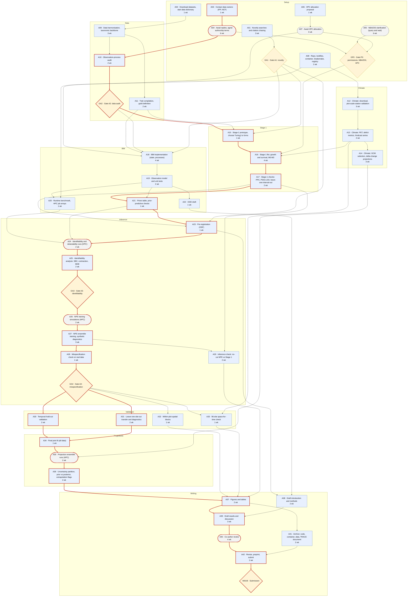

# Paper A: Schedule Network

*Precedence table and activity-on-node (AON) diagram for Paper A, built from [ROADMAP.md](../ROADMAP.md) §3 (with §1 and §2 where Paper A depends on them). Generated 2026-11-22.*

*To change the schedule, edit the activity list in [cpm_paperA.py](cpm_paperA.py) and run `python3 planning/cpm_paperA.py` from the repo root. That rewrites the table (§3) and the diagram (§4). The numbers quoted in §2 are not regenerated; update them by hand from the summary the script prints.*

## 1. Conventions

- **Activity-on-node (AON).** Nodes are activities and arrows are dependencies. Every dependency is **finish-to-start**: an activity can begin only after all its predecessors have finished.
- **Durations** are in calendar weeks at 0.5 FTE. One month is about 4.35 weeks. Durations are single-point estimates (see §5 for adding uncertainty).
- **Activity types:**
  - **Effort:** needs your hands-on time. You can do only one at a time.
  - **Wait/HPC:** elapsed time that needs almost none of your time, such as waiting for replies or an allocation, HPC runs, or co-author review.
  - **Milestone:** zero duration. Decision gates (§1.2 of the roadmap) and submission are milestones.
- **CPM columns** (Critical Path Method; unlimited people):

  | Column | Meaning | How it's computed |
  |---|---|---|
  | **ES** | Earliest start | Forward pass: the latest EF among the predecessors |
  | **EF** | Earliest finish | ES + duration |
  | **LS** | Latest start | Backward pass: LF − duration |
  | **LF** | Latest finish without delaying submission | Backward pass: the earliest LS among the successors |
  | **Float** | Total float (slack) | LS − ES |

  **Critical** (●) marks activities with zero float. Together they form the critical path: delay any of them and submission slips.

  All of these are week offsets from the project start, so ES = 0 means the activity starts in week 1.
- **Levelled schedule** (you alone). CPM assumes enough people to run every ready activity at once. Here only one *Effort* activity runs at a time, while *Wait/HPC* activities run freely alongside. When several Effort activities are ready, the one with the smallest LS goes first (the least slack, so it's the most urgent).
  - "Levelled finish month" uses the roadmap's convention: M1 is the first month.
- **Not included:**
  - Paper B background screening from M4, which takes about 10% of your time (its effect is estimated in §2).
  - Revisions after submission.

## 2. What the network shows

### 2.1 Headline numbers

| Quantity | Value |
|---|---|
| Total effort (sum of Effort durations) | **68 weeks** (about 15.7 months) |
| CPM duration (unlimited people) | 46 weeks (about 10.6 months) |
| **Levelled duration (you alone)** | **70 weeks → submission in M17** |
| Levelled duration including Paper B background from M4 (+10% load, roughly weeks 13–61) | about 75 weeks → submission in **about M18** |
| Roadmap target (§3.11) | M15 (about 65 weeks) |

**The binding constraint is your time, not the dependency logic.** With one person, the project can't finish in fewer weeks than the 68 weeks of Effort work. The 46-week CPM duration is out of reach, because most of the plan's parallelism is waiting or HPC time, not parallel work.

The levelled schedule reaches 70 weeks: the 68 weeks of work plus 2 weeks idle during co-author review, when nothing else is left to do.

### 2.2 Mismatch with the roadmap

This bottom-up estimate (68 effort-weeks) is about **20% above** the roadmap's top-down budget for Paper A (§0.4: 13 half-time months, about 56 weeks). It also places the gates later than §1.2 and §3.11 do:

| Milestone | Roadmap | Levelled schedule |
|---|---|---|
| Gate A1 (novelty) | M2 | M4 (week 14) |
| Gate P0 (permissions, NBA/DSI, HPC) | M2 | M3 (week 9) |
| Gate A2 (data audit) | M3 | M4 (week 16) |
| Gate A3 (identifiability) | M9 | M10 (week 41) |
| Gate A4 (misspecification) | M11 | M12 (week 48) |
| Submission | M15 | M17 (week 70); about M18 with Paper B background |

You know your working speed better than I do, so **check the durations in the table first**. Then either update §0.4, §1.2 and §3.11 of the roadmap to these numbers, or tell me which durations are too long and I'll recompute.

### 2.3 Critical path (CPM)

A03 Contact data owners → A04 Await replies → A10 Observation-process audit → **GA2** → A15 Stage-1 prototype → A16 Stage-1 fits → A17 Stage-1 checks → A21 Priors → A23 Pre-registration → A24 Identifiability runs → A25 Identifiability analysis → **GA3** → A26 NPE training simulations → A27 NPE ensemble and diagnostics → A28 Misspecification check → **GA4** → A30 Temporal hold-out ∥ A31 Leave-one-site-out → A34 Final joint fit → A35 Projection runs → A36 Uncertainty partition → A37 Figures → A39 Results and discussion → A40 Co-author review → A42 Submit → **Submission**

### 2.4 What follows from it

1. **The first critical activity is an email.** The observation-process audit (A10) needs the data owners' answers on census completeness, census dates and POM records. So the reply time (A04, assumed to be 6 weeks) sits on the critical path. Every extra week of waiting delays submission by a week.
   - Send the emails on day 1.
   - Do as much of the audit as possible from published metadata first, so the reply only confirms it.
2. **The gates are on the critical path:** A2, A3 and A4, but not A1 or P0. A failed gate that needs rework, such as the one allowed structural revision at A4, delays submission directly. Budget for that risk.
3. **Activities with float can be used to fill waiting periods.** With one person, slack matters mainly as a source of work to do while HPC runs or reviews are pending:
   - A14 GCM selection and delta change: 21 weeks of float.
   - A22 ODD draft: 19 weeks.
   - A38 Introduction and methods draft: 17 weeks.
   - A29 Inference check: 6 weeks.
   - A32 and A33 (spatial blocks, 96-site check): 6 weeks each.
   - A41 Archive and TRACE document: 5 weeks.

   The levelled schedule already places several of them in waiting periods.
4. **Parallel critical activities become sequential with one person.** A30 and A31 (the temporal hold-out and leave-one-site-out validation) are both critical and run side by side in CPM. Done one after the other, they add 2 weeks.
5. **The HPC waits are short** (2 weeks each for A24, A26 and A35). Queue times vary, so record actual waits and update the network.
6. **Gate A1 is a predecessor of the model-building work** (A15 Stage-1 prototype and A18 IBM implementation) as well as of pre-registration (A23). This forces the novelty check to finish before you invest in modelling, in case the paper needs repositioning.

## 3. Precedence table

Rows are grouped by phase. Durations, ES, EF, LS, LF and Float are in weeks.

<!-- BEGIN GENERATED TABLE (planning/cpm_paperA.py) -->
| ID | Activity | Type | Dur (wk) | Predecessors | ES | EF | LS | LF | Float | Critical | Levelled start–finish (wk) | Levelled finish month |
|---|---|---|---|---|---|---|---|---|---|---|---|---|
| | **Setup** | | | | | | | | | | | |
| A01 | Novelty searches and citation chasing | Effort | 3 | – | 0 | 3 | 6 | 9 | 6 |  | 11–14 | M4 |
| A02 | Download datasets; start data dictionary | Effort | 1 | – | 0 | 1 | 3 | 4 | 3 |  | 1–2 | M1 |
| A03 | Contact data owners (IFP, NCF) | Effort | 1 | – | 0 | 1 | 0 | 1 | 0 | ● | 0–1 | M1 |
| A04 | Await replies; agree authorship terms | Wait/HPC | 6 | A03 | 1 | 7 | 1 | 7 | 0 | ● | 1–7 | M2 |
| A05 | NBA/DSI clarification (query and wait) | Wait/HPC | 6 | – | 0 | 6 | 4 | 10 | 4 |  | 0–6 | M2 |
| A06 | HPC allocation proposal | Effort | 1 | – | 0 | 1 | 3 | 4 | 3 |  | 2–3 | M1 |
| A07 | Await HPC allocation | Wait/HPC | 6 | A06 | 1 | 7 | 4 | 10 | 3 |  | 3–9 | M3 |
| A08 | Repo, lockfiles, container, Snakemake, registry | Effort | 2 | – | 0 | 2 | 3 | 5 | 3 |  | 3–5 | M2 |
| GA1 | **Gate A1: novelty** | Milestone | 0 | A01 | 3 | 3 | 9 | 9 | 6 |  | 14–14 | M4 |
| GP0 | **Gate P0: permissions, NBA/DSI, HPC** | Milestone | 0 | A04, A05, A07 | 7 | 7 | 10 | 10 | 3 |  | 9–9 | M3 |
| | **Data** | | | | | | | | | | | |
| A09 | Data harmonisation; taxonomic backbone | Effort | 3 | A02 | 1 | 4 | 4 | 7 | 3 |  | 5–8 | M2 |
| A10 | Observation-process audit | Effort | 2 | A09, A04 | 7 | 9 | 7 | 9 | 0 | ● | 14–16 | M4 |
| GA2 | **Gate A2: data audit** | Milestone | 0 | A10 | 9 | 9 | 9 | 9 | 0 | ● | 16–16 | M4 |
| A11 | Trait compilation; guild definition | Effort | 2 | A09 | 4 | 6 | 7 | 9 | 3 |  | 16–18 | M5 |
| | **Climate** | | | | | | | | | | | |
| A12 | Climate: download; plot-scale station validation | Effort | 3 | A08 | 2 | 5 | 5 | 8 | 3 |  | 8–11 | M3 |
| A13 | Climate: PET, deficit metrics, hindcast series | Effort | 2 | A12 | 5 | 7 | 8 | 10 | 3 |  | 18–20 | M5 |
| A14 | Climate: GCM selection; delta-change projections | Effort | 3 | A13 | 7 | 10 | 28 | 31 | 21 |  | 36–39 | M9 |
| | **Stage 1** | | | | | | | | | | | |
| A15 | Stage-1 prototype; choose Turing.jl or brms | Effort | 1 | GA2, A11, GA1 | 9 | 10 | 9 | 10 | 0 | ● | 20–21 | M5 |
| A16 | Stage-1 fits: growth and survival, M0-M3 | Effort | 4 | A15, A13, GP0 | 10 | 14 | 10 | 14 | 0 | ● | 21–25 | M6 |
| A17 | Stage-1 checks: PPC, PSIS-LOO, leave-one-interval-out | Effort | 2 | A16 | 14 | 16 | 14 | 16 | 0 | ● | 29–31 | M8 |
| | **IBM** | | | | | | | | | | | |
| A18 | IBM implementation (state, processes) | Effort | 4 | A08, A11, GA2, GA1 | 9 | 13 | 10 | 14 | 1 |  | 25–29 | M7 |
| A19 | Observation model and unit tests | Effort | 2 | A18 | 13 | 15 | 14 | 16 | 1 |  | 31–33 | M8 |
| A20 | Runtime benchmark; HPC job arrays | Effort | 1 | A19, A07 | 15 | 16 | 17 | 18 | 2 |  | 34–35 | M9 |
| A21 | Priors table; prior-predictive checks | Effort | 1 | A17, A19 | 16 | 17 | 16 | 17 | 0 | ● | 33–34 | M8 |
| A22 | ODD draft | Effort | 1 | A19 | 15 | 16 | 34 | 35 | 19 |  | 41–42 | M10 |
| | **Inference** | | | | | | | | | | | |
| A23 | Pre-registration (OSF) | Effort | 1 | A17, A21, GA1 | 17 | 18 | 17 | 18 | 0 | ● | 35–36 | M9 |
| A24 | Identifiability and detectability runs (HPC) | Wait/HPC | 2 | A20, A21, A23 | 18 | 20 | 18 | 20 | 0 | ● | 36–38 | M9 |
| A25 | Identifiability analysis: SBC, contraction, MDE | Effort | 2 | A24 | 20 | 22 | 20 | 22 | 0 | ● | 39–41 | M10 |
| GA3 | **Gate A3: identifiability** | Milestone | 0 | A25 | 22 | 22 | 22 | 22 | 0 | ● | 41–41 | M10 |
| A26 | NPE training simulations (HPC) | Wait/HPC | 2 | GA3 | 22 | 24 | 22 | 24 | 0 | ● | 41–43 | M10 |
| A27 | NPE ensemble training; synthetic diagnostics | Effort | 3 | A26 | 24 | 27 | 24 | 27 | 0 | ● | 44–47 | M11 |
| A28 | Misspecification check on real data | Effort | 1 | A27 | 27 | 28 | 27 | 28 | 0 | ● | 47–48 | M12 |
| GA4 | **Gate A4: misspecification** | Milestone | 0 | A28 | 28 | 28 | 28 | 28 | 0 | ● | 48–48 | M12 |
| A29 | Inference check: no-cut NPE vs Stage 1 | Effort | 2 | A27, A17 | 27 | 29 | 33 | 35 | 6 |  | 48–50 | M12 |
| | **Validation** | | | | | | | | | | | |
| A30 | Temporal hold-out validation | Effort | 2 | GA4 | 28 | 30 | 28 | 30 | 0 | ● | 50–52 | M12 |
| A31 | Leave-one-site-out transfer and diagnostics | Effort | 2 | GA4 | 28 | 30 | 28 | 30 | 0 | ● | 52–54 | M13 |
| A32 | Within-plot spatial blocks | Effort | 1 | GA4 | 28 | 29 | 34 | 35 | 6 |  | 55–56 | M13 |
| A33 | 96-site space-for-time check | Effort | 1 | GA4, A13 | 28 | 29 | 34 | 35 | 6 |  | 56–57 | M14 |
| | **Projections** | | | | | | | | | | | |
| A34 | Final joint fit (all data) | Effort | 1 | A30, A31 | 30 | 31 | 30 | 31 | 0 | ● | 54–55 | M13 |
| A35 | Projection ensemble runs (HPC) | Wait/HPC | 2 | A34, A14 | 31 | 33 | 31 | 33 | 0 | ● | 55–57 | M14 |
| A36 | Uncertainty partition; prior vs posterior; extrapolation flags | Effort | 2 | A35 | 33 | 35 | 33 | 35 | 0 | ● | 57–59 | M14 |
| | **Writing** | | | | | | | | | | | |
| A37 | Figures and tables | Effort | 2 | A36, A32, A33, A29 | 35 | 37 | 35 | 37 | 0 | ● | 59–61 | M15 |
| A38 | Draft introduction and methods | Effort | 2 | A23, A22 | 18 | 20 | 35 | 37 | 17 |  | 42–44 | M11 |
| A39 | Draft results and discussion | Effort | 3 | A37, A38 | 37 | 40 | 37 | 40 | 0 | ● | 61–64 | M15 |
| A40 | Co-author review | Wait/HPC | 4 | A39 | 40 | 44 | 40 | 44 | 0 | ● | 64–68 | M16 |
| A41 | Archive: code, container, data, TRACE document | Effort | 2 | A37 | 37 | 39 | 42 | 44 | 5 |  | 64–66 | M16 |
| A42 | Revise, preprint, submit | Effort | 2 | A40, A41 | 44 | 46 | 44 | 46 | 0 | ● | 68–70 | M17 |
| MSUB | **Submission** | Milestone | 0 | A42 | 46 | 46 | 46 | 46 | 0 | ● | 70–70 | M17 |
<!-- END GENERATED TABLE -->

## 4. AON diagram

**Legend**

| Element | Meaning |
|---|---|
| Rectangle (blue) | Effort activity |
| Stadium shape (grey, dashed border) | Wait or HPC activity |
| Diamond (yellow) | Gate or milestone |
| Thick red border | Activity on the critical path |
| Thick red arrow | Arrow on the critical path |

Boxes group the activities by phase. Arrows can cross between phases.

<!-- BEGIN GENERATED DIAGRAM (planning/cpm_paperA.py) -->

<!-- END GENERATED DIAGRAM -->

## 5. Next steps for this schedule

1. **Review the durations** (§3). They are my estimates and they drive every number above.
2. **Add uncertainty (PERT).** Give each activity an optimistic, most-likely and pessimistic duration. Expected duration = (o + 4m + p)/6. A Monte Carlo run over the network then gives a *distribution* of submission dates, such as "80% chance by M18", rather than a single date. The waiting activities (A04, A05, A07, A40) are the most uncertain.
3. **Track actual progress.** Record the actual start and finish of each activity, recompute, and watch how float is used up. A non-critical activity that overruns its float becomes critical.
